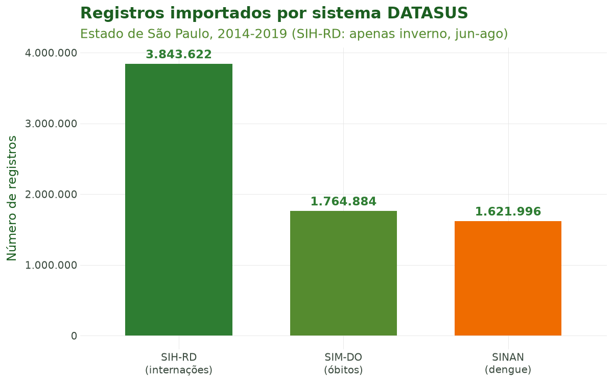
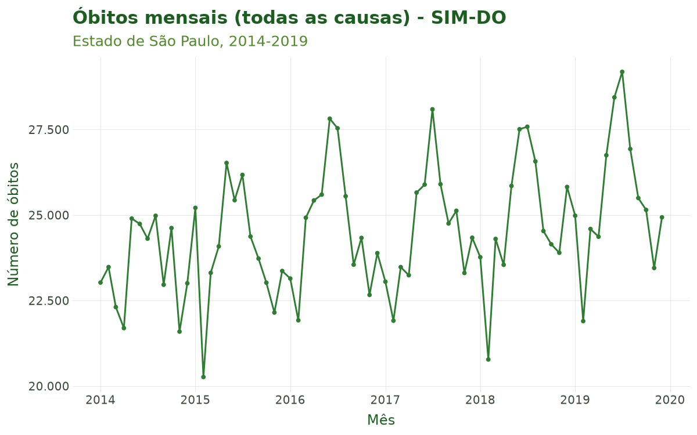

# Tutorial 1: Importação de Dados do DATASUS

[← Voltar para a Trilha do Pipeline](pipeline.md)

## Objetivo

Ao final deste tutorial você será capaz de importar microdados dos Sistemas de Informação em
Saúde do DATASUS com uma única função — `sus_data_import()` — e de controlar seus principais
recursos: a escolha do sistema (SIM, SIH, SINAN, SINASC, CNES, SIA) e seus subsistemas, o
recorte espacial (por UF, por região predefinida ou por município), a diferença entre sistemas
anuais e mensais e — fundamental para trabalhos reprodutíveis e de grande volume — o
**cache**, que evita baixar os mesmos dados duas vezes.

A importação é a primeira etapa do pipeline do climasus4py. Tudo o que vem depois
(padronização, filtragem, criação de variáveis, agregação, junção espacial, vínculo
socioeconômico, integração climática e modelagem) parte da base bruta construída aqui.

## Contexto científico

A pesquisa em clima e saúde no Brasil apoia-se nos **Sistemas de Informação em Saúde (SIS)**
mantidos pelo Ministério da Saúde e disponibilizados pelo DATASUS. Cada sistema registra um tipo
de evento, com cobertura nacional e granularidade municipal:

- **SIM** — Sistema de Informações sobre Mortalidade (declarações de óbito);
- **SIH** — Sistema de Informações Hospitalares (internações/AIH);
- **SINAN** — Sistema de Informação de Agravos de Notificação (doenças notificáveis, como
  dengue, zika e chikungunya);
- **SINASC** — Sistema de Informações sobre Nascidos Vivos;
- **CNES** — Cadastro Nacional de Estabelecimentos de Saúde;
- **SIA** — Sistema de Informações Ambulatoriais.

O DATASUS publica esses dados em arquivos `.dbc`. O climasus4py baixa os arquivos diretamente
do servidor do DATASUS, lê cada um com o
[climasus_readdbc_py](https://github.com/climasus/climasus_readdbc_py) e o guarda em **cache**
no formato Parquet, para não baixar os mesmos dados a cada execução. O resultado é uma consulta
do [DuckDB](https://duckdb.org/): os dados ficam em disco e só são carregados na memória quando
você pede. Importar de forma reprodutível — registrando sistema, ano e recorte espacial — é o
que torna um estudo auditável e replicável.

**Caso condutor.** Ao longo de toda a série de tutoriais investigamos a **temperatura e os
desfechos de saúde em idosos (60+) na Região Metropolitana de São Paulo, 2014–2019**. Neste
primeiro tutorial montamos a base bruta multissistema: óbitos (SIM-DO), internações (SIH-RD) e,
como caso secundário de clima × arboviroses, dengue (SINAN-DENGUE). Os objetos importados aqui
servirão de entrada para o Tutorial 2 (Limpeza e Padronização).

## Dados utilizados

| Sistema | `system=` | Periodicidade | Papel no caso |
|---|---|---|---|
| SIM-DO (óbitos) | `"SIM-DO"` | Anual | Desfecho principal (mortalidade) |
| SIH-RD (internações) | `"SIH-RD"` | Mensal (aceita `month`) | Morbidade hospitalar |
| SINAN-DENGUE | `"SINAN-DENGUE"` | Anual | Caso secundário (clima × dengue) |

Recorte espacial: estado de São Paulo (`uf="SP"`), 2014–2019. Todos os dados são públicos e
reais, obtidos do DATASUS.

## Pipeline completo

Os blocos abaixo reproduzem o que o script
[`tools/tutoriais/tutorial_01_importacao.py`](https://github.com/climasus/climasus4py/blob/main/tools/tutoriais/tutorial_01_importacao.py)
executa. Comece carregando o pacote:

```python
import climasus4py as cs
```

### Importar um sistema anual (SIM-DO)

O SIM é **anual**: cada ano é um arquivo, e o argumento `month` não se aplica. Pedimos os seis
anos de uma vez; o cache vem ligado por padrão.

```python
obitos = cs.sus_data_import(
    system="SIM-DO",
    uf="SP",
    year=[2014, 2015, 2016, 2017, 2018, 2019],
)
```

**Visualizar dados**

```python
obitos.columns            # nomes das colunas
obitos.limit(5).df()      # as cinco primeiras linhas, como tabela do pandas
```

### Importar um sistema mensal (SIH-RD)

O SIH é **mensal**: cada mês é um arquivo. Com `month`, você escolhe quais meses baixar; sem
ele, vêm os doze. Aqui pedimos apenas os meses de inverno (junho a agosto), quando a mortalidade
respiratória de idosos tende a ser mais alta.

```python
internacoes = cs.sus_data_import(
    system="SIH-RD",
    uf="SP",
    year=[2014, 2015, 2016, 2017, 2018, 2019],
    month=[6, 7, 8],                # junho, julho e agosto
)
```

**Visualizar dados**

```python
internacoes.limit(5).df()
```

### Importar notificações (SINAN-DENGUE)

```python
dengue = cs.sus_data_import(
    system="SINAN-DENGUE",
    uf="SP",
    year=[2014, 2015, 2016, 2017, 2018, 2019],
)
```

**Visualizar dados**

```python
dengue.limit(5).df()
```

### Recorte espacial: por região ou por município

Em vez de listar UFs, você pode usar um **grupo predefinido** em `region` (macrorregiões, biomas
ou bacias) — útil para estudos regionais:

```python
# Toda a macrorregião Sudeste (ES, MG, RJ, SP) de uma vez:
obitos_sudeste = cs.sus_data_import(
    system="SIM-DO",
    region="sudeste",
    year=2019,
)
```

Para ficar com um único **município**, use `sus_filter()` sobre os dados importados. O código
IBGE pode ter 7 dígitos (`"3550308"`) ou 6 (`"355030"`, a forma gravada pelo DATASUS); para
filtrar pelo nome, use `city=`:

```python
# Apenas o município de São Paulo (código IBGE 3550308):
obitos_muni_sp = cs.sus_filter(obitos, municipality="3550308")

# O mesmo recorte, pelo nome:
obitos_muni_sp = cs.sus_filter(obitos, city="São Paulo")
```

O DATASUS publica um arquivo por estado, então o recorte por município é feito depois do
download — o arquivo de São Paulo é baixado uma vez e fica no cache.

### (Opcional) Reler dados já exportados

Depois de exportar a base com `sus_data_export()`, você pode relê-la em sessões futuras sem
baixar de novo, com `sus_data_read()`, que detecta o formato pela extensão:

```python
cs.sus_data_export(obitos, "output/sim_sp_2014_2019.parquet")

obitos = cs.sus_data_read("output/sim_sp_2014_2019.parquet")
```

Ao final desta etapa temos `obitos`, `internacoes` e `dengue` — a **base bruta multissistema**
que alimentará os próximos tutoriais.

## Características das funções

### `sus_data_import()`

A porta de entrada da etapa de importação.

| Argumento | Essencial? | Descrição |
|---|---|---|
| `system` | sim | Sistema/subsistema (ver tabela de sistemas abaixo) |
| `uf` / `region` | sim (um deles) | UF(s) (`"SP"`, `["SP", "RJ"]`, `"all"`) ou grupo predefinido (`"sudeste"`, `"amazonia_legal"`, …) |
| `year` | sim | Ano(s) com 4 dígitos (ex.: `2019` ou `[2014, 2015, 2016, 2017, 2018, 2019]`) |
| `month` | só mensais | Mês(es) de 1 a 12, para SIH, CNES e SIA; sem ele, vêm os doze meses |
| `cache` | recomendado | `True` (padrão) reaproveita downloads anteriores |
| `cache_dir` | opcional | Pasta do cache (padrão: `dados/cache`, na pasta onde você está trabalhando) |
| `timeout` | opcional | Tempo máximo de cada download, em segundos (padrão: 600) |
| `path` / `data` | opcional | Lê um arquivo local (`.parquet` ou `.csv`) ou um `pandas.DataFrame`, em vez de baixar |
| `verbose` | opcional | Mostra o progresso (padrão: `True`) |

**Retorno:** uma consulta do DuckDB (`DuckDBPyRelation`) com as variáveis originais do sistema.
Nada é carregado na memória até você pedir — por exemplo, com `.df()`, que devolve uma tabela do
pandas.

**Cache.** Cada combinação de sistema, UF, ano e mês vira um arquivo Parquet em `cache_dir`,
reaproveitado automaticamente nas chamadas seguintes. Para baixar de novo, apague o arquivo
correspondente ou use `cache=False`.

### `sus_data_read()`

Relê arquivos já exportados, sem voltar à fonte. Detecta o formato pela extensão.

| Argumento | Descrição |
|---|---|
| `path` | Caminho de um arquivo, uma lista de arquivos, uma pasta ou um padrão como `"cache/*.parquet"` |
| `format` | `None` (detecta) ou `"parquet"`, `"csv"` |
| `read_metadata` | Recupera os metadados do pipeline gravados junto com o arquivo |

**Retorno:** uma consulta do DuckDB sobre os arquivos lidos. Vários arquivos são combinados pelo
nome das colunas.

## Sistemas e subsistemas suportados

**Tabela 1.** Sistemas do DATASUS acessíveis por `sus_data_import()`.

| Sistema | Descrição | Exemplos de `system` | Periodicidade |
|---|---|---|---|
| SIM | Mortalidade (declarações de óbito) | SIM-DO, SIM-DOFET, SIM-DOINF, SIM-DOMAT, SIM-DOEXT | Anual |
| SIH | Internações hospitalares (AIH) | SIH-RD, SIH-RJ, SIH-SP, SIH-ER | Mensal |
| SINASC | Nascidos vivos | SINASC | Anual |
| SINAN | Agravos de notificação (doenças notificáveis) | SINAN-DENGUE, SINAN-ZIKA, SINAN-CHIKUNGUNYA, SINAN-MALARIA, … | Anual |
| CNES | Estabelecimentos de saúde | CNES-LT, CNES-ST, CNES-EQ, CNES-PF, … | Mensal |
| SIA | Atendimentos ambulatoriais | SIA-PA, SIA-AB, SIA-AD, … | Mensal |

Atalhos de `region` (baixam várias UFs de uma vez):

**Tabela 2.** Exemplos de grupos predefinidos aceitos em `region`.

| Grupo | Tipo | UFs |
|---|---|---|
| `sudeste` | Macrorregião IBGE | ES, MG, RJ, SP |
| `sul` | Macrorregião IBGE | PR, RS, SC |
| `nordeste` | Macrorregião IBGE | AL, BA, CE, MA, PB, PE, PI, RN, SE |
| `norte` | Macrorregião IBGE | AC, AP, AM, PA, RO, RR, TO |
| `centro_oeste` | Macrorregião IBGE | DF, GO, MT, MS |
| `amazonia_legal` | Bioma/fronteira ecológica | AC, AP, AM, PA, RO, RR, MT, MA, TO |
| `mata_atlantica` | Bioma | AL, BA, CE, ES, GO, MA, MG, MS, PB, PE, PI, PR, RJ, RN, RS, SC, SE, SP |
| `cerrado` | Bioma | BA, DF, GO, MA, MG, MS, MT, PA, PI, PR, RO, SP, TO |
| `bacia_sao_francisco` | Bacia hidrográfica | AL, BA, DF, GO, MG, PE, SE |
| `semi_arido` | Recorte climático | AL, BA, CE, MA, PB, PE, PI, RN, SE, MG |

Estrutura típica do SIM-DO logo após a importação (causa básica em `CAUSABAS`, idade codificada
em `IDADE`, município de residência em `CODMUNRES`):

**Tabela 3.** Amostra das colunas-chave do SIM-DO importado.

| DTOBITO | DTNASC | SEXO | IDADE | RACACOR | CAUSABAS | CODMUNRES | CODMUNOCOR |
|---|---|---|---|---|---|---|---|
| 2014-01-28 | 2001-02-04 | 2 | 412 | 1 | X959 | 355030 | 355030 |
| 2014-01-28 | 1968-03-01 | 2 | 445 | 1 | C509 | 355030 | 355030 |
| 2014-01-28 | 1954-11-04 | 2 | 459 | 1 | C509 | 355030 | 351300 |
| 2014-01-28 | 1967-04-29 | 1 | 446 | 4 | I219 | 355030 | 355030 |
| 2014-01-28 | 1930-10-15 | 2 | 483 | 1 | I330 | 350410 | 350410 |
| 2014-01-01 | 1960-07-10 | 1 | 453 | 1 | K746 | 352940 | 352940 |
| 2014-01-01 | 1928-02-15 | 2 | 485 | 1 | I259 | 352940 | 352940 |
| 2014-01-01 | 1935-12-31 | 2 | 478 | 1 | C260 | 352940 | 352940 |
| 2014-01-01 | 1937-09-14 | 1 | 476 | 1 | G709 | 351380 | 351380 |
| 2014-01-01 | 1955-05-03 | 1 | 458 | 2 | C159 | 352470 | 352470 |

As datas (`DTOBITO`, `DTNASC`) já chegam convertidas em datas na importação. Os demais campos
mantêm os códigos do DATASUS: `SEXO` 1 = masculino e 2 = feminino; `IDADE` com três dígitos, em
que o primeiro é a unidade (4 = anos) e os outros dois, a quantidade (`445` = 45 anos). A
tradução desses códigos é feita no Tutorial 2, pelo `sus_data_standardize()`.

## Resultados ilustrados



**Figura 1.** Número de registros importados por sistema para São Paulo, 2014–2019 (o SIH-RD
foi restrito ao inverno, junho–agosto, para manter o exemplo leve). A ordem de grandeza muito
diferente entre sistemas ajuda a dimensionar memória e tempo de download.



**Figura 2.** Série mensal de óbitos (todas as causas) do SIM-DO em São Paulo, 2014–2019. A
sazonalidade de inverno já é visível na base bruta e será o ponto de partida para os recortes
(idosos, causas respiratórias) dos próximos tutoriais.

## Referências

- Ministério da Saúde (Brasil). DATASUS — Departamento de Informática do SUS. Disponível em:
  <https://datasus.saude.gov.br>.

## Navegação

- [Voltar para a Trilha do Pipeline](pipeline.md)
- **Próximo:** [Tutorial 2 — Limpeza e Padronização](02-limpeza-padronizacao.md)
