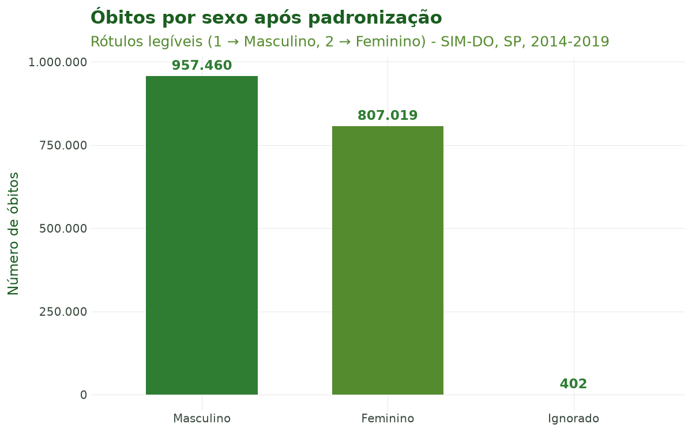
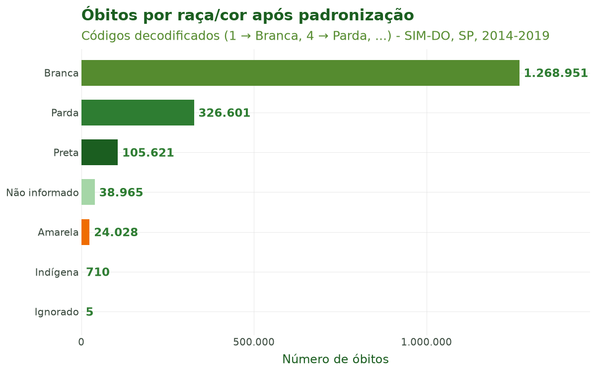

# Tutorial 2: Limpeza e Padronização

[← Voltar para a Trilha do Pipeline](pipeline.md)

## Objetivo

Ao final deste tutorial você será capaz de **deixar a base bruta do DATASUS pronta para
análise**, executando as duas funções da segunda etapa do pipeline:

1. **`sus_data_clean_encoding()`** — remove os **registros repetidos** e os que têm **idade
   impossível**;
2. **`sus_data_standardize()`** — **traduz os nomes das colunas** para nomes legíveis e
   **decodifica os valores categóricos** (por exemplo, `SEXO = 1` vira `"Masculino"` e
   `RACACOR = 4` vira `"Parda"`), além de converter as colunas de data. Tudo isso em três
   idiomas: português, inglês e espanhol.

Esta é a **segunda etapa** do pipeline (importar → limpar → padronizar → …). Ela transforma uma
tabela com nomes crípticos e códigos numéricos numa tabela legível, que os tutoriais seguintes
(filtragem, criação de variáveis, agregação) conseguem manipular sem ambiguidade.

## Contexto científico

Os campos do SIM, do SIH, do SINAN e dos demais sistemas chegam com **nomes abreviados**
(`CAUSABAS`, `CODMUNRES`, `DTOBITO`) e **categorias codificadas em números** (Brasil, Ministério
da Saúde). Trabalhar diretamente com esses códigos é frágil e propenso a erro. A padronização para
um **vocabulário controlado e legível** — e a possibilidade de produzi-lo em três idiomas — é o
que torna a análise reprodutível e comunicável a leitores de diferentes países (princípio FAIR de
interoperabilidade; Wilkinson et al., 2016).

Os arquivos do DATASUS gravam o texto em Latin1 (ISO-8859-1), uma codificação antiga em que
acentos e cedilhas aparecem corrompidos quando lidos como UTF-8. No climasus4py, essa conversão
para UTF-8 **já é feita na importação**, quando o arquivo é lido: "São Paulo" chega escrito
corretamente. Por isso, aqui o `sus_data_clean_encoding()` cuida de outra parte da limpeza:
registros repetidos e idades impossíveis.

**Caso condutor.** Investigamos a **temperatura e os desfechos de saúde em idosos (60+) na
Região Metropolitana de São Paulo, 2014–2019**. No Tutorial 1 montamos a base bruta
multissistema. Aqui pegamos a base de **óbitos (SIM-DO)**, limpamos e padronizamos nomes e
categorias (sexo, raça/cor, CID, datas). O resultado é a entrada do Tutorial 3 (Filtragem).

## Dados utilizados

| Objeto | Origem | Papel no caso |
|---|---|---|
| `obitos` | SIM-DO, SP, 2014–2019 (Tutorial 1) | Base bruta a ser limpa e padronizada |
| Dicionários de tradução pt/en/es | climasus-data | Mapeiam nomes e códigos para rótulos legíveis |

## Pipeline completo

Os blocos abaixo reproduzem o que o script
[`tools/tutoriais/tutorial_02_limpeza_padronizacao.py`](https://github.com/climasus/climasus4py/blob/main/tools/tutoriais/tutorial_02_limpeza_padronizacao.py)
executa. Comece carregando o pacote e a base do tutorial anterior — como os arquivos já estão no
cache, a importação é imediata:

```python
import climasus4py as cs

obitos = cs.sus_data_import(system="SIM-DO", uf="SP", year=[2014, 2015, 2016, 2017, 2018, 2019])
```

### Passo 1 — Limpar

`sus_data_clean_encoding()` remove os **registros repetidos** — linhas idênticas em todas as
colunas — e os registros com **idade fora de uma faixa plausível** (de 0 a 120 anos, por
padrão). A idade do SIM vem codificada em três dígitos e é decodificada antes da comparação.

```python
obitos_limpo = cs.sus_data_clean_encoding(obitos)
```

Na base de São Paulo, 2014–2019, não há linhas repetidas, e 3 registros têm idade impossível:
**1.764.884** registros entram e **1.764.881** saem.

Os dois critérios podem ser ajustados:

```python
# Outra faixa de idade plausível:
obitos_limpo = cs.sus_data_clean_encoding(obitos, age_range=(0, 110))

# Sem remover registros repetidos:
obitos_limpo = cs.sus_data_clean_encoding(obitos, dedup=False)
```

### Passo 2 — Padronizar nomes e categorias

`sus_data_standardize()` **detecta automaticamente o sistema** (SIM, SIH, SINAN, …), traduz os
nomes das colunas para o vocabulário controlado e decodifica os valores categóricos no idioma
escolhido. Também converte as colunas de data.

```python
obitos_padr = cs.sus_data_standardize(obitos_limpo, lang="pt")   # "pt", "en" ou "es"
```

**Visualizar dados**

```python
obitos_padr.limit(5).df()
```

| data_obito | sexo | raca | causa_basica | codigo_municipio_residencia | local_ocorrencia_obito |
|---|---|---|---|---|---|
| 2016-01-01 | Masculino | Branca | F179 | 354580 | Hospital |
| 2016-01-01 | Masculino | Parda | G309 | 351660 | Domicílio |
| 2016-01-01 | Masculino | Preta | C61 | 351380 | Hospital |
| 2016-01-01 | Feminino | Branca | I509 | 354580 | Hospital |
| 2016-01-01 | Masculino | Parda | I358 | 351350 | Domicílio |

*(Seis das 88 colunas.)*

### As duas etapas juntas

Cada função recebe o resultado da anterior. A etapa completa fica assim:

```python
obitos_limpo = cs.sus_data_clean_encoding(obitos)
obitos_padr = cs.sus_data_standardize(obitos_limpo, lang="pt")
```

Ao final, `obitos_padr` é a base **limpa e padronizada** — com o estágio `standardize` registrado
nos metadados (`cs.sus_meta(obitos_padr, "stage")`) — que usamos no próximo tutorial.

## Características das funções

### `sus_data_clean_encoding()`

| Argumento | Essencial? | Descrição |
|---|---|---|
| `rel` | sim | Saída de `sus_data_import()` |
| `dedup` | opcional | `True` (padrão) remove os registros repetidos |
| `dedup_cols` | opcional | Colunas que identificam um registro. Sem ele (padrão), um registro repetido é uma linha idêntica em todas as colunas |
| `age_range` | opcional | Faixa de idade plausível, em anos (padrão: `(0, 120)`). Registros com idade fora dela são removidos; os com idade desconhecida são mantidos |

**Retorno:** os dados sem os registros removidos, com o estágio `clean` e uma entrada no
histórico do pipeline.

### `sus_data_standardize()`

| Argumento | Essencial? | Descrição |
|---|---|---|
| `rel` | sim | Saída de `sus_data_clean_encoding()` (ou de `sus_data_import()`) |
| `lang` | opcional | Idioma de **nomes e rótulos**: `"en"` (padrão), `"pt"` ou `"es"` |
| `system` | opcional | Força o sistema (ex.: `"SIM-DO"`); sem ele, o sistema é detectado pelas colunas |

**Etapas internas.** (1) Identifica o sistema; (2) traduz os nomes das colunas pelo dicionário do
sistema e do idioma; (3) decodifica os valores categóricos (ex.: `SEXO`, `RACACOR`, `LOCOCOR`);
(4) converte as colunas de data.

**Retorno:** os dados com nomes e valores padronizados, com o estágio `standardize` e o sistema
registrados nos metadados.

## Nomes e dicionários

Os dicionários de tradução ficam no pacote **climasus-data**, instalado junto com o
climasus4py. Há um dicionário por sistema (SIM, SIH, SINAN, SINASC, CNES, SIA) e por idioma. A
mesma coluna recebe um nome em cada idioma:

**Tabela 1.** Os mesmos campos do SIM-DO padronizados em português, inglês e espanhol.

| Original (DATASUS) | pt | en | es |
|---|---|---|---|
| `DTOBITO` | `data_obito` | `death_date` | `fecha_muerte` |
| `SEXO` | `sexo` | `sex` | `sexo` |
| `RACACOR` | `raca` | `race` | `raza` |
| `CAUSABAS` | `causa_basica` | `underlying_cause` | `causa_basica` |
| `CODMUNRES` | `codigo_municipio_residencia` | `residence_municipality_code` | `codigo_municipio_residencia` |
| `LOCOCOR` | `local_ocorrencia_obito` | `death_location` | `lugar_ocurrencia_muerte` |

A tabela abaixo mostra uma amostra do dicionário em **português** usado para decodificar os
valores categóricos do caso condutor:

**Tabela 2.** Amostra do dicionário de tradução do SIM (pt): código numérico → rótulo legível.

| Variável | Código | Rótulo |
|---|---|---|
| SEXO → sexo | 0 | Ignorado |
| SEXO → sexo | 1 | Masculino |
| SEXO → sexo | 2 | Feminino |
| SEXO → sexo | 9 | Ignorado |
| RACACOR → raca | 1 | Branca |
| RACACOR → raca | 2 | Preta |
| RACACOR → raca | 3 | Amarela |
| RACACOR → raca | 4 | Parda |
| RACACOR → raca | 5 | Indígena |
| RACACOR → raca | 9 | Ignorado |
| LOCOCOR → local_ocorrencia_obito | 1 | Hospital |
| LOCOCOR → local_ocorrencia_obito | 2 | Outro estabelecimento de saúde |
| LOCOCOR → local_ocorrencia_obito | 3 | Domicílio |
| LOCOCOR → local_ocorrencia_obito | 4 | Via pública |
| LOCOCOR → local_ocorrencia_obito | 5 | Outros |
| LOCOCOR → local_ocorrencia_obito | 6 | Aldeia indígena |
| LOCOCOR → local_ocorrencia_obito | 9 | Ignorado |

## Resultados ilustrados



**Figura 1.** Distribuição de óbitos por **sexo** após a padronização. Os códigos numéricos do
SIM (`1`, `2`) foram decodificados para rótulos legíveis (`Masculino`, `Feminino`) por
`sus_data_standardize()`, prontos para uso em gráficos e tabelas. Os 402 óbitos com sexo ignorado
continuam na base, com o rótulo `Ignorado`.



**Figura 2.** Distribuição de óbitos por **raça/cor** após a padronização. Os códigos (`1`–`5`,
`9`) foram traduzidos para `Branca`, `Preta`, `Amarela`, `Parda`, `Indígena` e `Ignorado`. A barra
`Não informado` reúne os 38.965 óbitos em que o campo veio **em branco** do DATASUS — diferente de
`Ignorado`, que é um código preenchido. Essa decodificação é pré-requisito para análises de
equidade em saúde nas etapas seguintes.

**Tabela 3.** Resumo da etapa.

| Indicador | Valor |
|---|---|
| Linhas (importado) | 1.764.884 |
| Linhas (depois da limpeza) | 1.764.881 |
| Colunas (importado) | 88 |
| Colunas (padronizado) | 88 |
| Sistema detectado | SIM-DO |
| Estágio (`sus_meta`) | `standardize` |
| Idioma de saída | pt |

## Referências

- Brasil. Ministério da Saúde. *Manual de Instruções para o preenchimento da Declaração de
  Óbito*. Brasília: Ministério da Saúde. (Define os códigos das variáveis do SIM, como `SEXO`,
  `RACACOR` e `LOCOCOR`.)
- Wilkinson, M. D., et al. (2016). The FAIR Guiding Principles for scientific data management and
  stewardship. *Scientific Data*, 3, 160018.

## Navegação

- [Voltar para a Trilha do Pipeline](pipeline.md)
- **Anterior:** [Tutorial 1 — Importação de Dados do DATASUS](01-importacao.md)
- **Próximo:** [Tutorial 3 — Filtragem](03-filtragem.md)
