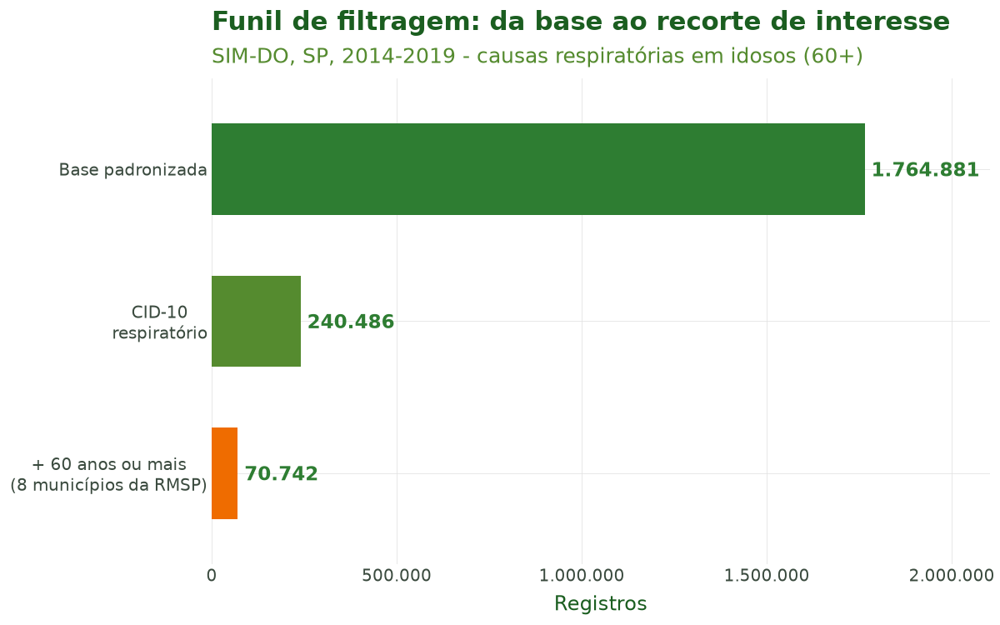
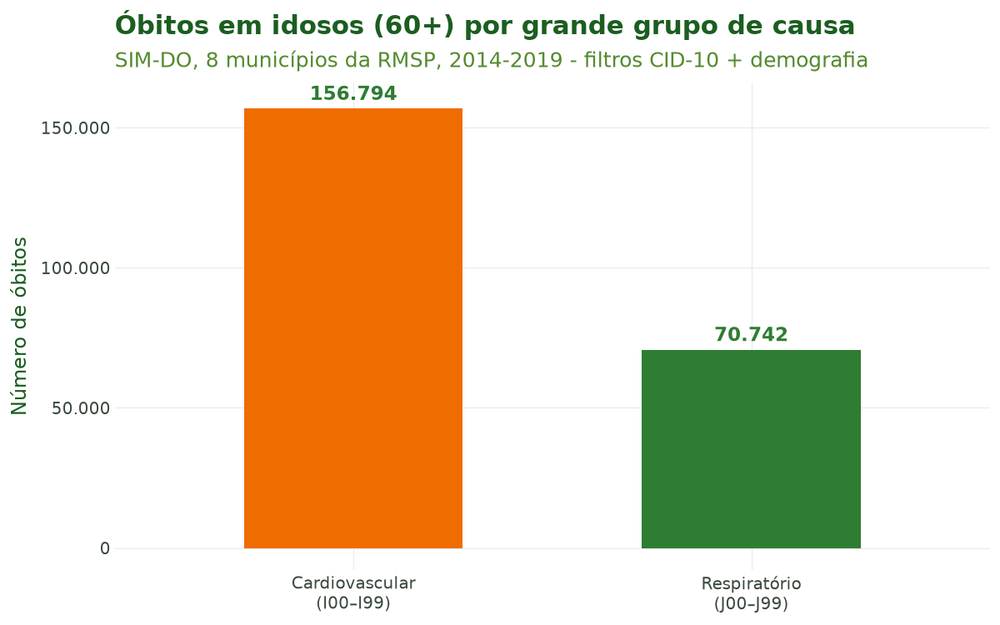
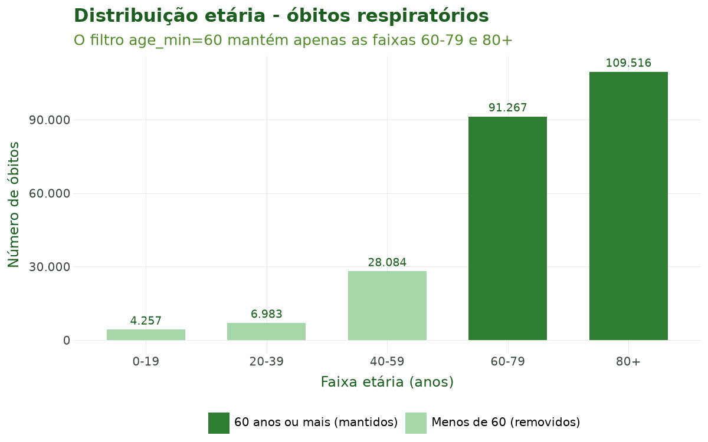
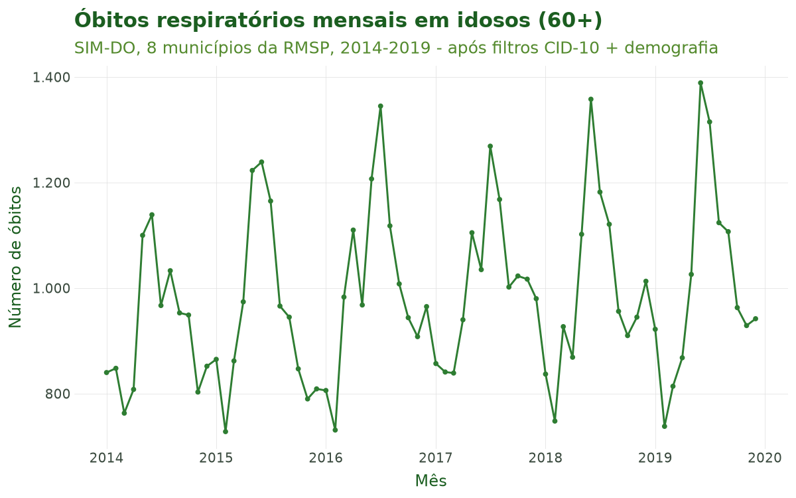

# Tutorial 3: Filtragem

[← Voltar para a Trilha do Pipeline](pipeline.md)

## Objetivo

Ao final deste tutorial você será capaz de **recortar os microdados de saúde já padronizados**
segundo dois eixos complementares, com uma única função, `sus_filter()`:

1. **Por doença (CID-10)** — selecionando códigos específicos, intervalos ou um dos **64 grupos
   de doença predefinidos** do pacote;
2. **Por características demográficas e geográficas** — restringindo por sexo, raça/cor, **faixa
   etária**, escolaridade, região, UF ou município.

Você também conhecerá `list_disease_groups()` e `sus_data_cid_select()`, que ajudam a descobrir
os nomes dos grupos de doença sem precisar memorizar códigos CID-10.

A filtragem é a **terceira etapa** do pipeline (importar → limpar → padronizar → **filtrar** →
criar variáveis → agregar → …).

## Contexto científico

Estudos de **clima e saúde** raramente analisam todos os óbitos ou internações de uma vez: o
interesse recai sobre **desfechos sensíveis ao clima** em **subpopulações vulneráveis**. A
literatura é consistente ao mostrar que os extremos térmicos afetam de forma desproporcional as
causas **respiratórias** (CID-10 capítulo J, J00–J99) e **cardiovasculares** (capítulo I,
I00–I99), sobretudo entre **idosos** (Gasparrini et al., 2015; Bhaskaran et al., 2013).

A **Classificação Internacional de Doenças, 10ª revisão (CID-10)**, organiza as causas em
capítulos identificados por letra inicial e em códigos de três a quatro caracteres (OMS, 2016). O
climasus4py traduz essa estrutura em uma sintaxe de filtragem flexível — código único, intervalo
(`"J00-J99"`) ou grupo nomeado (`"respiratory"`) — e detecta automaticamente a coluna de causa de
cada sistema do DATASUS (`causa_basica` no SIM, `diagnostico_principal` no SIH).

Recortar **antes** de agregar é também uma boa prática de reprodutibilidade: o histórico do
pipeline registra exatamente quais códigos e critérios demográficos foram aplicados, tornando o
estudo auditável.

**Caso condutor.** Investigamos a **temperatura e os desfechos de saúde em idosos (60+) na
Região Metropolitana de São Paulo, 2014–2019**. Neste tutorial recortamos, a partir da base
padronizada do Tutorial 2, as **causas respiratórias (J00–J99)** e **cardiovasculares
(I00–I99)** e restringimos à **população idosa (60 anos ou mais)** residente em oito municípios
da RMSP. O resultado alimenta o Tutorial 4 (Variáveis e Agregação).

## Dados utilizados

Entrada: a base SIM-DO **padronizada** em português produzida pelo Tutorial 2 (colunas como
`causa_basica`, `sexo` e `codigo_municipio_residencia`).

| Recorte | Critério | Argumento de `sus_filter()` |
|---|---|---|
| Causas respiratórias | CID-10 J00–J99 | `groups="respiratory"` |
| Causas cardiovasculares | CID-10 I00–I99 | `codes="I00-I99"` |
| Idosos | 60 anos ou mais | `age_min=60` |
| RMSP | nomes de 8 municípios | `city=[...]` |

## Pipeline completo

Os blocos abaixo reproduzem o que o script
[`tools/tutoriais/tutorial_03_filtragem.py`](https://github.com/climasus/climasus4py/blob/main/tools/tutoriais/tutorial_03_filtragem.py)
executa. Comece carregando o pacote e a base padronizada do tutorial anterior:

```python
import climasus4py as cs

obitos = cs.sus_data_import(system="SIM-DO", uf="SP", year=[2014, 2015, 2016, 2017, 2018, 2019])
obitos_limpo = cs.sus_data_clean_encoding(obitos)
obitos_padr = cs.sus_data_standardize(obitos_limpo, lang="pt")
```

### Explorar grupos de doença

`list_disease_groups()` lista os grupos disponíveis — com rótulo, descrição, códigos CID-10 e se
o grupo é sensível ao clima — e `get_disease_group_details()` mostra um deles:

```python
grupos = cs.list_disease_groups(lang="pt")                               # os 64 grupos
sensiveis = cs.list_disease_groups(climate_sensitive_only=True, lang="pt")

cs.get_disease_group_details("respiratory")
```

`sus_data_cid_select()` abre uma página no navegador com todos os grupos, para escolher
visualmente. Marque os grupos de interesse e clique em **Copiar selecionados**: a área de
transferência recebe a linha de código pronta — por exemplo,
`cs.sus_filter(rel, groups=["respiratory", "cardiovascular"])` —, bastando trocar `rel` pelos
seus dados.

```python
cs.sus_data_cid_select(lang="pt")    # abre no navegador

# Com os grupos já escolhidos, devolve os códigos CID-10 correspondentes:
selecao = cs.sus_data_cid_select(groups=["respiratory", "cardiovascular"])
selecao.codes                        # ['J00-J99', 'I00-I99']
```

### Filtrar por CID-10

Há duas formas de indicar as causas: pelo **grupo nomeado** (mais legível) ou pelo **intervalo de
códigos** (mais explícito). A coluna de causa (`causa_basica`, no SIM-DO) é **detectada
automaticamente**. Abaixo, as causas respiratórias são recortadas pelo nome do grupo e as
cardiovasculares, pelo intervalo de códigos:

```python
# (a) Respiratório (J00-J99), pelo nome do grupo:
resp = cs.sus_filter(obitos_padr, groups="respiratory")

# (b) Cardiovascular (I00-I99), pelo intervalo de códigos:
cardio = cs.sus_filter(obitos_padr, codes="I00-I99")
```

As duas formas são equivalentes: como o grupo `"cardiovascular"` é definido pelos códigos
I00–I99, `cs.sus_filter(obitos_padr, groups="cardiovascular")` devolve exatamente os mesmos
registros que `cardio`.

### Filtrar por demografia (idosos 60+ na RMSP)

O recorte demográfico é aplicado sobre o subconjunto respiratório. A idade é calculada a partir
do código de idade do DATASUS, sem precisar de nenhuma etapa anterior; o recorte espacial usa o
**nome** de oito municípios da Região Metropolitana de São Paulo, com o argumento `city`:

```python
# Oito municípios da RMSP:
RMSP = ["São Paulo", "Guarulhos", "São Bernardo do Campo", "Santo André",
        "Osasco", "Mauá", "Carapicuíba", "Diadema"]

resp_idosos = cs.sus_filter(resp, age_min=60, city=RMSP)
cardio_idosos = cs.sus_filter(cardio, age_min=60, city=RMSP)
```

Os critérios de doença e de demografia também podem ir **na mesma chamada** — o resultado é o
mesmo:

```python
resp_idosos = cs.sus_filter(obitos_padr, groups="respiratory", age_min=60, city=RMSP)
```

Em vez do nome, você pode usar o **código IBGE** do município, com 6 ou 7 dígitos, no argumento
`municipality`; e também filtrar por **sexo, raça ou escolaridade** ou por **região**
predefinida:

```python
# Pelo código IBGE (São Paulo = 3550308) e por sexo:
mulheres_sp = cs.sus_filter(resp, sex="Feminino", municipality="3550308")

# Por macrorregião (atalho que resolve para um conjunto de UFs):
sudeste = cs.sus_filter(resp, region="sudeste")
```

Os valores de sexo, raça e escolaridade seguem o idioma escolhido na padronização (`"Feminino"`
em português, `"Female"` em inglês).

Ao final desta etapa temos `resp_idosos` e `cardio_idosos` — os **recortes de interesse** que
alimentarão o Tutorial 4.

## Características das funções

### `sus_filter()`

Filtra por doença e por características demográficas e geográficas. Todos os critérios são
opcionais e se combinam (um registro precisa atender a todos); sem nenhum critério, os dados
voltam inalterados.

| Argumento | Descrição |
|---|---|
| `groups` | Grupo(s) de doença nomeado(s): `"respiratory"`, `"cardiovascular"`, `"dengue"`, … |
| `codes` | Código(s) ou intervalo(s) CID-10: `"J18"`, `["I21", "I22"]`, `"J00-J99"` |
| `icd_column` | Coluna de causa; sem ele, é detectada automaticamente |
| `match_type` | `"starts_with"` (padrão) ou `"exact"` |
| `age_min` / `age_max` | Idade mínima e máxima, em anos; sem `age_max`, não há limite superior |
| `sex` / `race` / `education` | Valores no idioma dos dados: `"Feminino"`, `"Parda"`, … |
| `uf` | UF(s), pela sigla (`"SP"`) ou pelo código IBGE (`"35"`) |
| `region` | Grupo predefinido de UFs (`"sudeste"`, `"semi_arido"`, …) |
| `municipality` | Código(s) IBGE de município, com 6 ou 7 dígitos |
| `city` | Nome(s) de município |
| `date_start` / `date_end` | Período, no formato `"AAAA-MM-DD"` |
| `drop_ignored` | `True` remove os valores "Ignorado" e vazios das variáveis demográficas |

**Retorno:** os dados filtrados, com o estágio `filter` e os critérios aplicados registrados no
histórico do pipeline.

### `list_disease_groups()` e `get_disease_group_details()`

Listam os grupos de doença e os detalhes de um grupo. **Não alteram os dados** — servem para
descobrir os nomes a usar em `sus_filter(groups=...)`.

| Argumento | Descrição |
|---|---|
| `climate_sensitive_only` | `True` lista apenas os grupos sensíveis ao clima |
| `lang` | `"pt"` (padrão), `"en"`, `"es"` |

### `sus_data_cid_select()`

Seletor visual de grupos de doença.

| Argumento | Descrição |
|---|---|
| `output` | `"browser"` (página no navegador, padrão), `"console"` (lista no terminal) ou `"notebook"` (seletor dentro do notebook; requer `pip install ipywidgets`) |
| `climate_sensitive_only` | `True` mostra apenas os grupos sensíveis ao clima |
| `groups` | Grupos já escolhidos (dispensa a interface) |
| `lang` | `"pt"` (padrão), `"en"`, `"es"` |

**Retorno:** a seleção, com os grupos (`.groups`) e os códigos CID-10 (`.codes`). No modo
`"browser"`, a escolha é feita na página e copiada com o botão **Copiar selecionados**.

## Sintaxe de códigos CID-10

Um **intervalo** `"J00-J99"` é expandido para a sequência de códigos J00, J01, …, J99. O
parâmetro `match_type` define como cada código é comparado à coluna de causa:

- **`"starts_with"`** (padrão) — prefixo: `"I10"` casa `"I10"`, `"I100"` e `"I109"`, o que
  reflete a hierarquia da CID-10;
- **`"exact"`** — igualdade exata: `"I10"` casa apenas `"I10"`.

## Resultados ilustrados

**Tabela 1.** Grupos de doença CID-10 de interesse no caso condutor (de `list_disease_groups()`).

| Grupo | Códigos CID-10 | Sensível ao clima | Descrição |
|---|---|---|---|
| `"respiratory"` | J00-J99 | Sim | Doenças Respiratórias |
| `"cardiovascular"` | I00-I99 | Sim | Doenças Cardiovasculares |
| `"pneumonia"` | J12-J18 | Sim | Pneumonia |
| `"ischemic_heart"` | I20-I25 | Sim | Doença Isquêmica do Coração |

**Tabela 2.** Funil de filtragem: registros mantidos a cada etapa.

| Etapa | Registros | % da base |
|---|---|---|
| Base padronizada (Tutorial 2) | 1.764.881 | 100,0 |
| CID-10: respiratório (J00–J99) | 240.486 | 13,6 |
| CID-10: cardiovascular (I00–I99) | 521.349 | 29,5 |
| + demografia: respiratório, 60+, 8 municípios da RMSP | 70.742 | 4,0 |
| + demografia: cardiovascular, 60+, 8 municípios da RMSP | 156.794 | 8,9 |



**Figura 1.** Funil de filtragem. Cada barra mostra quantos registros permanecem após a base
padronizada, o recorte por CID-10 (respiratório, J00–J99) e o recorte demográfico (idosos 60+
residentes em oito municípios da RMSP).



**Figura 2.** Óbitos em idosos (60+) por grande grupo de causa, após a filtragem combinada
(CID-10 + demografia). A comparação entre os capítulos respiratório (J) e cardiovascular (I) é o
ponto de partida da análise de sensibilidade ao clima dos próximos tutoriais.



**Figura 3.** Distribuição etária dos óbitos respiratórios no estado. O filtro `age_min=60`
mantém apenas as faixas 60–79 e 80+, deixando explícito o efeito do recorte demográfico sobre a
população analisada.



**Figura 4.** Série mensal de óbitos respiratórios em idosos (60+) em oito municípios da RMSP,
2014–2019, após a filtragem. A sazonalidade de inverno — esperada para causas respiratórias — já
aparece no recorte e será confrontada com a temperatura nas etapas de clima e modelagem.

## Referências

- Bhaskaran, K., Gasparrini, A., Hajat, S., Smeeth, L., & Armstrong, B. (2013). Time series
  regression studies in environmental epidemiology. *International Journal of Epidemiology*,
  42(4), 1187–1195.
- Gasparrini, A., Guo, Y., Hashizume, M., et al. (2015). Mortality risk attributable to high and
  low ambient temperature: a multicountry observational study. *The Lancet*, 386(9991), 369–375.
- Organização Mundial da Saúde. (2016). *CID-10: Classificação Estatística Internacional de
  Doenças e Problemas Relacionados à Saúde*, 10ª revisão.

## Navegação

- [Voltar para a Trilha do Pipeline](pipeline.md)
- **Anterior:** [Tutorial 2 — Limpeza e Padronização](02-limpeza-padronizacao.md)
- **Próximo:** [Tutorial 4 — Variáveis e Agregação](04-variaveis-agregacao.md)
