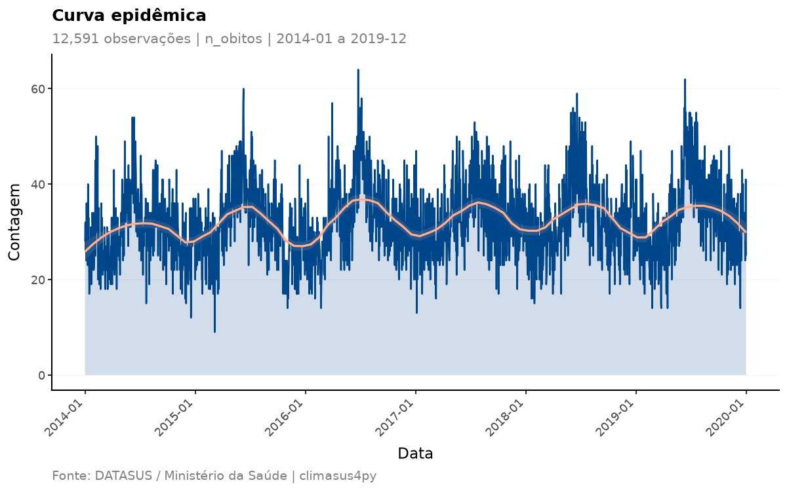
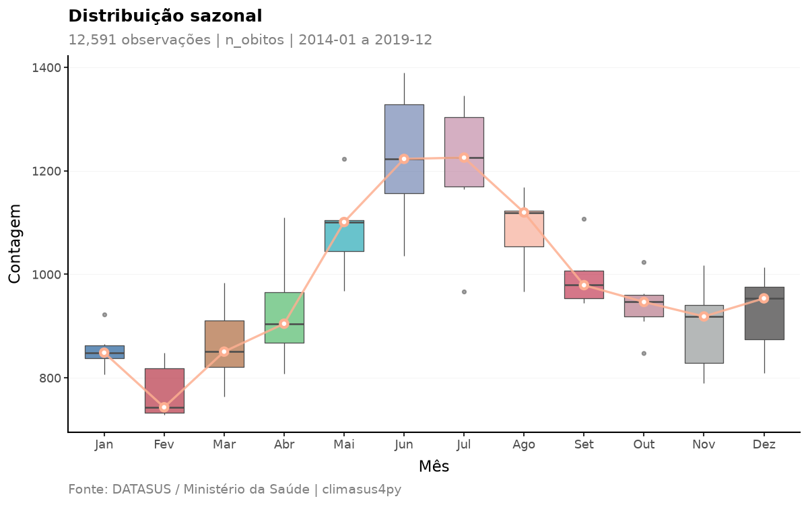
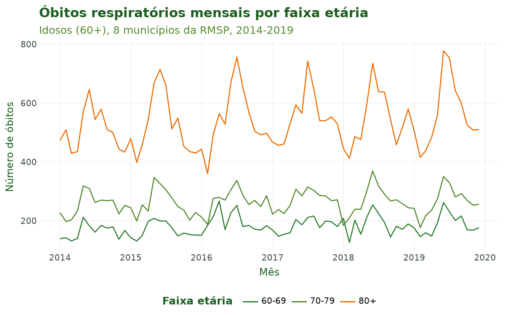
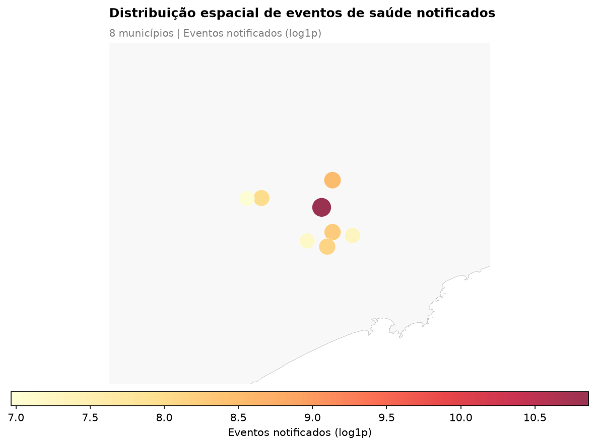

# Tutorial 4: Variáveis e Agregação

[← Voltar para a Trilha do Pipeline](pipeline.md)

## Objetivo

Ao final deste tutorial você será capaz de **transformar microdados individuais em uma série
temporal pronta para análise**. São duas operações encadeadas e duas de visualização:

1. **Criar variáveis derivadas** — `sus_data_create_variables()` — gerando **faixas etárias**
   (definidas por você, de risco climático e quinquenais do IBGE) e **variáveis de calendário**
   (ano, mês, trimestre, estação do ano);
2. **Agregar no tempo e no espaço** — `sus_data_aggregate()` — convertendo os registros
   individuais em **contagens por período e por município** (diária, mensal, sazonal etc.);
3. **Visualizar a série temporal** — `sus_data_plot_aggregate_ts()` — com curvas epidêmicas,
   boxplots sazonais, mapas de calor de calendário e tendências anuais;
4. **Visualizar a distribuição espacial** — `sus_data_plot_aggregate_map()` — com mapas de
   bolhas ou coropléticos municipais.

Esta é a **quarta etapa** do pipeline (criar variáveis → agregar). Ela ocupa um lugar crítico:
é aqui que os dados deixam de ser uma tabela de eventos individuais e passam a ter a forma
exigida pelos modelos clima–saúde do Tutorial 9 — uma contagem de óbitos por unidade de tempo.

## Contexto científico

Estudos de séries temporais em epidemiologia ambiental modelam a **contagem de desfechos por
período** (por exemplo, óbitos por dia) em função da exposição ambiental (temperatura,
poluição). Para isso, os microdados precisam ser **agregados** em uma grade temporal regular e,
frequentemente, estratificados por **faixa etária**, já que a vulnerabilidade ao calor e ao frio
varia muito com a idade (Gasparrini et al., 2015; Bhaskaran et al., 2013).

Duas decisões metodológicas desta etapa têm consequências diretas na análise:

- **A unidade temporal de agregação** (`time_unit`) define a resolução do estudo. Séries
  **diárias** captam efeitos agudos de curto prazo (ideais para o DLNM); séries **mensais** ou
  **sazonais** evidenciam padrões de longo prazo e sazonalidade (Bhaskaran et al., 2013).
- **O preenchimento de datas faltantes** (`complete_dates=True`) garante uma série **sem
  lacunas**: dias sem nenhum óbito recebem contagem zero. Sem isso, os modelos de série temporal
  interpretariam erroneamente a ausência de uma data como ausência de informação, e não como um
  zero verdadeiro.

As faixas etárias seguem categorizações reconhecidas — incluindo a estrutura **quinquenal do
IBGE** (0–4, 5–9, …, 80+), que assegura comparabilidade nacional e internacional — e uma **faixa
de risco climático** (0–4, 5–64, 65+) desenhada para destacar os grupos mais vulneráveis (IBGE,
2010; WHO, 2014).

**Caso condutor.** Investigamos a **temperatura e os desfechos de saúde em idosos (60+) na
Região Metropolitana de São Paulo, 2014–2019**. Partindo dos **óbitos respiratórios de idosos
filtrados** no Tutorial 3, criamos faixas etárias (60–69, 70–79, 80+) e variáveis de
calendário, e agregamos em **série diária** e em **série mensal por faixa etária**. A série
resultante alimenta a junção espacial (Tutorial 5) e, adiante, a modelagem (Tutorial 9).

## Dados utilizados

| Item | Detalhe |
|---|---|
| Entrada | `resp_idosos`, a saída do Tutorial 3 |
| Desfecho | Óbitos respiratórios (CID-10 J00–J99) em idosos (60+) |
| Sistema | SIM-DO (mortalidade) |
| Recorte | Oito municípios da Região Metropolitana de São Paulo, 2014–2019 |

## Pipeline completo

Os blocos abaixo reproduzem o que o script
[`tools/tutoriais/tutorial_04_variaveis_agregacao.py`](https://github.com/climasus/climasus4py/blob/main/tools/tutoriais/tutorial_04_variaveis_agregacao.py)
executa. Comece carregando o pacote e refazendo, a partir do cache, os passos dos tutoriais
anteriores:

```python
import climasus4py as cs

obitos = cs.sus_data_import(system="SIM-DO", uf="SP", year=[2014, 2015, 2016, 2017, 2018, 2019])
obitos_limpo = cs.sus_data_clean_encoding(obitos)
obitos_padr = cs.sus_data_standardize(obitos_limpo, lang="pt")

RMSP = ["São Paulo", "Guarulhos", "São Bernardo do Campo", "Santo André",
        "Osasco", "Mauá", "Carapicuíba", "Diadema"]
resp_idosos = cs.sus_filter(obitos_padr, groups="respiratory", age_min=60, city=RMSP)
```

### Criar variáveis derivadas

`sus_data_create_variables()` cria faixas etárias e variáveis de calendário em uma só chamada.
Aqui usamos faixas voltadas ao recorte de idosos do caso condutor e ligamos as variáveis
sazonais com a região climática `"sudeste"`.

```python
obitos_vars = cs.sus_data_create_variables(
    resp_idosos,
    create_age_groups=True,
    age_breaks=[60, 70, 80, 999],           # 999 = sem limite superior
    age_labels=["60-69", "70-79", "80+"],
    create_calendar_vars=True,              # ano, mês, trimestre, ...
    create_climate_vars=True,               # estação do ano
    climate_region="sudeste",               # região climática do caso
    hemisphere="south",                     # Brasil
    lang="pt",
)
```

Além de `faixa_etaria` (definida por `age_breaks` e `age_labels`), a função cria a **idade em
anos** (`idade_anos`), a **faixa de risco climático** (`grupo_risco_climatico`) e a **faixa
quinquenal do IBGE** (`faixa_etaria_ibge`). Com `create_calendar_vars=True`, cria `ano`, `mes`,
`trimestre`, `semana_epidemiologica` e outras variáveis de calendário; e, com `climate_region`
informada, a estação do ano (`estacao_climatica` e `estacao_seca_chuvosa`) — sem ela, a estação
astronômica (`estacao_astronomica`).

### Agregar em série temporal diária

`sus_data_aggregate()` converte os registros individuais em contagens. Com `fun="count"` e o
sistema SIM, a coluna de contagem recebe o nome `n_obitos`. `complete_dates=True` preenche os
dias sem óbito com zero.

```python
serie_diaria = cs.sus_data_aggregate(
    obitos_vars,
    time_unit="day",           # uma observação por dia
    fun="count",               # contagem de óbitos
    join_col="ocorrencia",     # conta pelo município onde o óbito ocorreu
    complete_dates=True,       # preenche dias sem evento com zero
    lang="pt",
)
```

As contagens saem **por dia e por município**: o argumento `join_col` escolhe qual município
usar — `"ocorrencia"` (onde o óbito ocorreu, o padrão para o SIM) ou `"residencia"` (onde a
pessoa morava).

### Agregar em série mensal por faixa etária

A mesma função, agora estratificando por `faixa_etaria`. Esta é a série usada nos próximos
tutoriais.

```python
serie_mensal = cs.sus_data_aggregate(
    obitos_vars,
    time_unit="month",
    fun="count",
    group_by=["faixa_etaria"],      # faixa etária criada acima
    join_col="ocorrencia",
    complete_dates=True,
    lang="pt",
)
```

### Visualizar a série temporal

`sus_data_plot_aggregate_ts()` recebe uma série agregada e produz gráficos prontos para
publicação. `plot_type` aceita `"epidemic"`, `"seasonal"`, `"heatmap"` e `"trend"` — ou uma
lista com vários deles.

```python
# Curva epidêmica diária com suavização loess
cs.sus_data_plot_aggregate_ts(
    serie_diaria,
    plot_type="epidemic",
    smooth_method="loess",
    palette="lancet",
    lang="pt",
)

# Boxplot da distribuição sazonal mensal
cs.sus_data_plot_aggregate_ts(
    serie_diaria,
    plot_type="seasonal",
    lang="pt",
)
```

### Visualizar a distribuição espacial

`sus_data_plot_aggregate_map()` mapeia as contagens por município, a partir de uma série
agregada que tenha a coluna de município. Para o mapa, agregamos pelo município de
**residência**: assim as bolhas mostram onde moravam os idosos do caso condutor — os oito
municípios da RMSP —, e não os locais onde os óbitos ocorreram, que se espalham por outros
municípios e estados.

```python
serie_muni = cs.sus_data_aggregate(
    obitos_vars,
    time_unit="month",
    fun="count",
    join_col="residencia",     # o município onde a pessoa morava
    lang="pt",
)

cs.sus_data_plot_aggregate_map(
    serie_muni,
    map_type="bubble",
    log_scale=True,
    palette="YlOrRd",
    lang="pt",
)
```

Ao final desta etapa temos `serie_mensal` (por faixa etária) e `serie_muni` (por município) — a
base temporal e espacial que alimenta os próximos tutoriais.

## Características das funções

### `sus_data_create_variables()`

Cria variáveis derivadas a partir da idade e da data do evento.

| Argumento | Essencial? | Descrição |
|---|---|---|
| `rel` | sim | Dados padronizados (saída de `sus_data_standardize()` ou de `sus_filter()`) |
| `create_age_groups` | sim | Cria `faixa_etaria`, `grupo_risco_climatico` e `faixa_etaria_ibge` (padrão `True`) |
| `age_breaks` | opcional | Cortes das faixas etárias; padrão `[0, 5, 15, 60, 999]`. Use `999` para "sem limite superior" |
| `age_labels` | opcional | Rótulos das faixas; sem ele, são gerados a partir de `age_breaks` |
| `create_calendar_vars` | sim | Cria `ano`, `mes`, `trimestre` etc. (padrão `True`) |
| `create_climate_vars` | opcional | Cria a estação do ano (padrão `True`) |
| `climate_region` | opcional | Região climática (`"norte"`, `"nordeste"`, `"centro-oeste"`, `"sudeste"`, `"sul"`); define a estação seca e chuvosa |
| `hemisphere` | opcional | `"south"` (padrão, Brasil) ou `"north"` |
| `age_col` / `date_col` | opcional | Forçam a coluna de idade ou de data; sem eles, são detectadas |
| `lang` / `verbose` | opcional | Idioma (`"pt"`, `"en"`, `"es"`) e mensagens |

**Retorno:** os dados com as novas colunas e o estágio `variables` registrado. A idade em anos
vem do **código de idade do DATASUS**, de três dígitos: o primeiro é a unidade (minutos, horas,
dias, meses ou anos) e os outros, a quantidade — `445` é 45 anos. Códigos que não são uma idade,
como `999` (idade ignorada), ficam sem idade.

### `sus_data_aggregate()`

Agrega os microdados individuais em uma série temporal de contagens.

| Argumento | Essencial? | Descrição |
|---|---|---|
| `rel` | sim | Dados padronizados, filtrados ou com variáveis criadas |
| `time_unit` | sim | `"day"`, `"week"`, `"month"` (padrão), `"quarter"`, `"year"`, `"season"`, `"5 days"` ou `"14 days"` |
| `fun` | opcional | `"count"` (padrão), `"sum"`, `"mean"`, `"median"`, `"min"`, `"max"`, `"sd"`, `"q25"`, `"q75"`, `"q95"`, `"q99"` ou um dicionário com vários |
| `group_by` | opcional | Colunas de estratificação, além do município (ex.: `["faixa_etaria", "sexo"]`) |
| `join_col` | opcional | Município usado na contagem: `"ocorrencia"` (padrão para o SIM) ou `"residencia"` (padrão para os demais sistemas) |
| `value_col` | só se `fun` não for `"count"` | Coluna numérica a agregar |
| `complete_dates` | recomendado | `True` preenche os períodos sem evento com zero (padrão `False`) |
| `date_col` | opcional | Coluna de data; sem ela, é detectada pelo sistema |
| `lang` / `verbose` | opcional | Idioma e mensagens |

**Retorno:** a série agregada, com uma coluna `date` (início do período), a coluna do município,
as colunas de `group_by` e a coluna de contagem, **nomeada pelo sistema**: `n_obitos` (SIM),
`n_internacoes` (SIH), `n_nascimentos` (SINASC), `n_casos` (SINAN), `n_procedimentos` (SIA),
`n_estabelecimentos` (CNES).

### `sus_data_plot_aggregate_ts()`

Gráficos de série temporal a partir de uma série agregada.

| Argumento | Descrição |
|---|---|
| `df` | Série agregada |
| `value_col` | Coluna do desfecho; sem ela, é detectada (`n_obitos`, `n_casos`, …) |
| `plot_type` | `"epidemic"` (curva epidêmica), `"seasonal"` (boxplot por mês), `"heatmap"` (calendário) ou `"trend"` (total de cada ano, com a variação percentual em relação ao ano anterior) — ou uma lista com vários |
| `group_col` / `facet_col` | Coluna para as cores e coluna para os painéis |
| `smooth_method` / `smooth_span` | Suavização da curva epidêmica: `"loess"` (padrão), `"gam"`, `"lm"` ou `"none"`; `smooth_span` (padrão `0.25`) controla o quanto a curva loess acompanha a série — quanto menor, mais de perto |
| `log_transform` | Aplica `log1p` no eixo vertical |
| `palette` | `"lancet"` (padrão), `"nejm"`, `"jco"`, `"nature"`, `"aaas"`, `"sus"`, `"colorblind"` |
| `title` / `subtitle` / `caption` | Textos do gráfico; sem eles, são gerados automaticamente |
| `save_path` | Caminho para salvar a figura (`width`, `height` e `dpi` ajustam o tamanho) |
| `lang` / `verbose` | Idioma e mensagens |

**Retorno:** o gráfico (um objeto do plotnine). Não altera os dados.

### `sus_data_plot_aggregate_map()`

Mapa municipal das contagens agregadas.

| Argumento | Descrição |
|---|---|
| `df` | Série agregada com a coluna do município |
| `value_col` | Coluna do desfecho; sem ela, é detectada |
| `map_type` | `"choropleth"` (padrão), `"bubble"` ou `"quantile_choropleth"` |
| `rate_per_100k` | `True` mostra a **taxa por 100 mil habitantes**: a contagem dividida pela população do município e multiplicada por 100.000 |
| `period` | `[início, fim]` para filtrar as datas antes de somar |
| `city` / `top_n` | Restringe a municípios; rotula os `top_n` maiores (no mapa de bolhas) |
| `state_borders` | Desenha as fronteiras estaduais |
| `palette` | Paleta de cores |
| `log_scale` | Escala de cor logarítmica |
| `title` / `subtitle` / `caption`, `save_path` | Como em `sus_data_plot_aggregate_ts()` |
| `lang` / `verbose` | Idioma e mensagens |

**Retorno:** o mapa (uma figura do matplotlib). Não altera os dados.

## Resultados ilustrados



**Figura 1.** Curva epidêmica diária de óbitos respiratórios em idosos (60+) em oito municípios
da Região Metropolitana de São Paulo, 2014–2019, gerada por
`sus_data_plot_aggregate_ts(plot_type="epidemic")`. A área e a linha mostram a contagem diária;
a curva suavizada (loess), com sua faixa de confiança, destaca a tendência de fundo — com um pico
a cada inverno.



**Figura 2.** Distribuição sazonal mensal (`sus_data_plot_aggregate_ts(plot_type="seasonal")`).
Cada caixa reúne o total de óbitos daquele mês em cada um dos seis anos, e a linha liga as
medianas. Os boxplots evidenciam a sazonalidade de inverno (junho–agosto) da mortalidade
respiratória de idosos — o ponto de partida da hipótese clima–saúde do caso condutor.



**Figura 3.** Série mensal estratificada pelas faixas etárias criadas em
`sus_data_create_variables()` (60–69, 70–79, 80+). Os óbitos se concentram na faixa de 80 anos
ou mais, que também tem os picos de inverno mais marcados.



**Figura 4.** Distribuição espacial dos óbitos por município de residência
(`sus_data_plot_aggregate_map(map_type="bubble")`). O tamanho e a cor das bolhas codificam o
total de óbitos de cada um dos oito municípios da RMSP (escala `log1p`); o município de São Paulo
concentra a maior parte.

**Tabela 1.** Amostra das variáveis derivadas por `sus_data_create_variables()` (faixas etárias e
calendário).

| data_obito | idade_anos | faixa_etaria | grupo_risco_climatico | faixa_etaria_ibge | ano | mes | trimestre | estacao_climatica | estacao_seca_chuvosa |
|---|---|---|---|---|---|---|---|---|---|
| 2015-02-05 | 90 | 80+ | Alto Risco (65+) | 80+ | 2015 | 2 | 1 | Chuvosa | Chuvosa |
| 2015-03-06 | 91 | 80+ | Alto Risco (65+) | 80+ | 2015 | 3 | 1 | Chuvosa | Chuvosa |
| 2015-10-07 | 68 | 60-69 | Alto Risco (65+) | 65-69 | 2015 | 10 | 4 | Chuvosa | Chuvosa |
| 2015-02-15 | 66 | 60-69 | Alto Risco (65+) | 65-69 | 2015 | 2 | 1 | Chuvosa | Chuvosa |
| 2015-11-30 | 62 | 60-69 | Risco Padrão (5-64) | 60-64 | 2015 | 11 | 4 | Chuvosa | Chuvosa |

**Tabela 2.** Resumo das séries agregadas: número de períodos, total de óbitos e intervalo de
datas. As linhas são mais numerosas que os períodos porque cada série tem uma linha por período e
por município (e, na mensal, por faixa etária).

| Série | Unidade | Períodos | Linhas | Total de óbitos | Início | Fim |
|---|---|---|---|---|---|---|
| Diária | dia | 2.191 | 12.591 | 70.742 | 2014-01-01 | 2019-12-31 |
| Mensal, por faixa etária | mês | 72 | 2.855 | 70.742 | 2014-01-01 | 2019-12-01 |

## Referências

- Bhaskaran, K., Gasparrini, A., Hajat, S., Smeeth, L., & Armstrong, B. (2013). Time series
  regression studies in environmental epidemiology. *International Journal of Epidemiology*,
  42(4), 1187–1195.
- Gasparrini, A., Guo, Y., Hashizume, M., Lavigne, E., Zanobetti, A., Schwartz, J., et al.
  (2015). Mortality risk attributable to high and low ambient temperature: a multicountry
  observational study. *The Lancet*, 386(9991), 369–375.
- Instituto Brasileiro de Geografia e Estatística (IBGE). (2010). *Censo Demográfico 2010*. Rio
  de Janeiro: IBGE.
- World Health Organization (WHO). (2014). *Quantitative risk assessment of the effects of
  climate change on selected causes of death, 2030s and 2050s*. Geneva: WHO.

## Navegação

- [Voltar para a Trilha do Pipeline](pipeline.md)
- **Anterior:** [Tutorial 3 — Filtragem](03-filtragem.md)
- **Próximo:** Tutorial 5 — Junção Espacial *(em preparação)*
