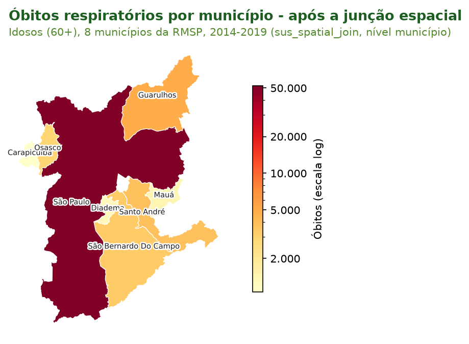
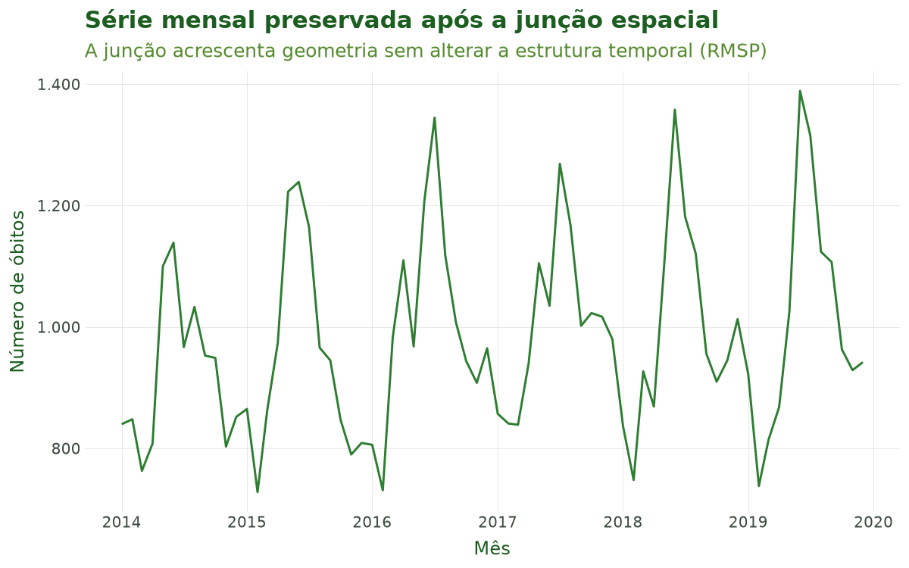
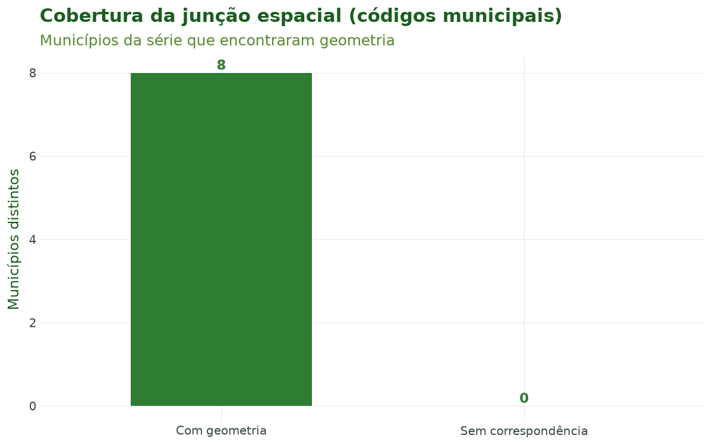

# Tutorial 5: Junção Espacial

[← Voltar para a Trilha do Pipeline](pipeline.md)

## Objetivo

Ao final deste tutorial você será capaz de **atribuir uma geometria a cada registro de saúde** —
ligando a série temporal construída na etapa anterior às **unidades geográficas oficiais do
Brasil** (municípios e estados) — com `sus_spatial_join()`, e de **integrar dados ambientais em
grade** ao pipeline de saúde com `sus_grid_join()`.

A junção espacial é a **quinta etapa** do pipeline do `climasus4py`. Ela transforma uma tabela
"comum" (saúde × data × código municipal) em uma tabela **com geometria explícita**, requisito
para mapear, calcular vizinhança e — fundamental no caso condutor — cruzar com indicadores
socioeconômicos (Tutorial 6) e com clima em grade (Tutorial 8).

## Contexto científico

Estudos de clima e saúde são, por natureza, **espaciais**: a exposição (temperatura, poluição) e
o desfecho (óbitos, internações) ocorrem em lugares concretos. Ligar o dado de saúde à sua
unidade geográfica permite mapear desigualdades, controlar confundidores contextuais e definir a
**unidade de análise**. Essa escolha não é neutra: o **Problema da Unidade de Área Modificável**
(MAUP; Openshaw, 1984) mostra que resultados estatísticos podem mudar conforme a escala
(município vs. estado) e o particionamento adotados.

No Brasil, as geometrias oficiais vêm do **IBGE** e são distribuídas pelo projeto `geobr`
(Pereira et al., 2019). O `climasus4py` lê essas malhas já preparadas do pacote `climasus-data`
— baixadas uma vez e guardadas em cache — e cuida da **normalização de códigos**, um ponto
sensível: o código municipal do IBGE tem **7 dígitos** (com dígito verificador), enquanto os
Sistemas de Informação em Saúde costumam gravar **6 dígitos**. A função alinha as duas
representações automaticamente. O sistema de referência de coordenadas é o **SIRGAS 2000**
(EPSG:4674), padrão oficial brasileiro.

**Chapéu do geógrafo.** Três cuidados atravessam esta etapa: (i) o **sistema de referência**
(use sempre o SIRGAS 2000 de forma consistente); (ii) a diferença entre o código IBGE de **6 e 7
dígitos** (resolvida pela função); e (iii) o **MAUP** — a escala e o recorte escolhidos afetam a
inferência, então documente-os.

**Caso condutor.** Investigamos **temperatura e desfechos em idosos (60+) na Região
Metropolitana de São Paulo, 2014–2019**. Nesta etapa, ligamos a série de óbitos respiratórios
(saída do Tutorial 4) aos **oito municípios da RMSP**, obtendo a tabela espacial que o Tutorial 6
(Socioeconômico) usará.

## Dados utilizados

| Insumo | Origem | Papel no caso |
|---|---|---|
| Série mensal por faixa etária e município de residência | Tutorial 4 (`sus_data_aggregate()`) | Entrada de saúde |
| Geometrias municipais e estaduais | IBGE, via `climasus-data` | Polígonos da RMSP e do estado |
| Grade climática (demonstração) | Sintética (o clima real entra no Tutorial 8) | Ilustra `sus_grid_join()` |

## Pipeline completo

Os blocos abaixo reproduzem o que o script
[`tools/tutoriais/tutorial_05_juncao_espacial.py`](https://github.com/climasus/climasus4py/blob/main/tools/tutoriais/tutorial_05_juncao_espacial.py)
executa. Comece carregando o pacote e refazendo, a partir do cache, os passos dos tutoriais
anteriores:

```python
import climasus4py as cs

obitos = cs.sus_data_import(system="SIM-DO", uf="SP", year=[2014, 2015, 2016, 2017, 2018, 2019])
obitos_limpo = cs.sus_data_clean_encoding(obitos)
obitos_padr = cs.sus_data_standardize(obitos_limpo, lang="pt")

RMSP = ["São Paulo", "Guarulhos", "São Bernardo do Campo", "Santo André",
        "Osasco", "Mauá", "Carapicuíba", "Diadema"]
resp_idosos = cs.sus_filter(obitos_padr, groups="respiratory", age_min=60, city=RMSP)

obitos_vars = cs.sus_data_create_variables(
    resp_idosos,
    age_breaks=[60, 70, 80, 999],
    age_labels=["60-69", "70-79", "80+"],
    climate_region="sudeste",
    lang="pt",
)
```

### Montar a série de saúde pelo município de residência

A série mensal por faixa etária do Tutorial 4, agora contada pelo município onde a pessoa
**morava**. É o município de residência que diz a qual clima o idoso estava exposto — e é ele que
mantém a série nos oito municípios da RMSP.

```python
serie = cs.sus_data_aggregate(
    obitos_vars,
    time_unit="month",
    group_by=["faixa_etaria"],
    join_col="residencia",     # o município onde a pessoa morava
    lang="pt",
)
```

### Ligar a série aos municípios com `sus_spatial_join()`

`sus_spatial_join()` acrescenta a cada linha a geometria do seu município, lida do
`climasus-data`. O nível padrão é `"municipality"`; `join_col` escolhe qual município usar —
aqui, o de residência, o mesmo da série:

```python
caso_espacial = cs.sus_spatial_join(
    serie,
    geo_level="municipality",  # município (padrão)
    join_col="residencia",     # coluna geográfica usada na junção
    lang="pt",
)
```

A geometria chega como **texto WKT** na coluna `geometry_wkt`. Para mapear ou fazer operações
espaciais, converta a tabela em um `GeoDataFrame` do `geopandas`:

```python
import geopandas as gpd

tabela = caso_espacial.df()
geometria = gpd.GeoSeries.from_wkt(tabela["geometry_wkt"])
mapa = gpd.GeoDataFrame(tabela, geometry=geometria, crs="EPSG:4674")
```

Com `geo_level="state"`, cada linha recebe o polígono e o nome do **estado** do seu município. As
linhas não são somadas: municípios do mesmo estado passam a compartilhar o mesmo polígono.

```python
caso_estado = cs.sus_spatial_join(serie, geo_level="state", join_col="residencia", lang="pt")
```

### Integrar dados ambientais em grade com `sus_grid_join()`

`sus_grid_join()` é a **ponte** entre o pipeline ambiental (as funções `sus_grid_*()`, que
produzem tabelas no estágio `climate`) e o pipeline de saúde. Ela une as duas tabelas por uma
chave espaço-temporal — aqui, o código do município com 7 dígitos (`code_muni_7`) e a data. O
clima real entra no Tutorial 8; aqui o uso é ilustrativo, com uma grade de temperatura inventada:

```python
import numpy as np

# Grade de demonstração: uma temperatura para cada município e mês da série
grade = tabela[["code_muni_7", "date"]].drop_duplicates()
sorteio = np.random.default_rng(7)
grade["t2m"] = sorteio.normal(21, 4, len(grade)).round(1)

caso_clima = cs.sus_grid_join(
    tabela,
    grade,
    by=["code_muni_7", "date"],  # chave espaço-temporal
    lang="pt",
)

caso_clima.attrs["sus_meta"]["stage"]  # "climate"
```

**Granularidade temporal.** Se a saúde for **mensal** e a grade **diária**, a junção por `date`
deixa a maior parte das linhas sem valor de clima. Nesse caso, agregue a grade antes (com
`sus_climate_aggregate()`) ou, para grades **anuais** (ex.: PRODES), una só pelo código do
município — o valor anual é repetido em todos os meses.

Ao final desta etapa temos `caso_espacial` — a série de saúde **com geometria**, que alimenta o
Tutorial 6.

## Características das funções

### `sus_spatial_join()`

Liga dados de saúde às geometrias oficiais do Brasil (malhas do IBGE distribuídas pelo
`climasus-data`).

| Argumento | Essencial? | Descrição |
|---|---|---|
| `rel` | sim | Dados de saúde com uma coluna de código municipal (padronizados, filtrados ou agregados) |
| `geo_level` | sim | Unidade geográfica: `"municipality"` (padrão) ou `"state"` |
| `join_col` | opcional | Município usado na junção: `"residencia"`, `"ocorrencia"`, `"notificacao"` ou o nome de uma coluna; sem ele, é detectado (residência primeiro) |
| `simplified` | opcional | `True` (padrão) usa a malha simplificada, mais leve; `False`, a malha completa |
| `spatial_path` | opcional | Caminho para um arquivo Parquet de geometrias próprio (colunas `code_muni`, `name` e `geometry_wkt`) |
| `lang` | opcional | Idioma dos nomes de estado e região (`"pt"`, `"en"`, `"es"`) |

**Retorno:** os dados com as colunas originais mais `spatial_name` (nome do município ou do
estado), `geometry_wkt` (a geometria em texto WKT — **POLYGON** ou **MULTIPOLYGON**),
`code_muni_7`, `code_state`, `abbrev_state`, `name_state`, `code_region` e `name_region`, e o
estágio `spatial` registrado.

**Normalização de códigos.** Aceita códigos municipais de **6 ou 7 dígitos** (o dígito
verificador é tratado automaticamente). A junção mantém **todas as linhas** de saúde: códigos sem
geometria correspondente ficam com `geometry_wkt` vazia — por isso vale conferir a cobertura
(Figura 3).

### `sus_grid_join()`

Une a saída de qualquer `sus_grid_*()` (no estágio `climate`) a uma tabela de saúde — agregada ou
já com geometria — produzindo uma tabela no estágio `climate`.

| Argumento | Essencial? | Descrição |
|---|---|---|
| `health_data` | sim | Dados de saúde com as colunas de `by` |
| `grid_data` | sim | Saída de uma função `sus_grid_*()`, com as colunas de `by` e ao menos uma variável ambiental |
| `by` | opcional | Chave de junção; padrão `["code_muni", "date"]`. Use só o código do município para grades anuais |
| `type_out` | opcional | Sobrescreve o tipo do resultado; sem ele, herda o da grade |
| `lang` / `verbose` | opcional | Idioma e mensagens |

**Retorno:** um `DataFrame` com as colunas de saúde mais as variáveis ambientais e o estágio
`climate` registrado em `attrs["sus_meta"]`. A junção mantém todas as linhas de saúde: as que não
têm grade correspondente recebem valor vazio (`NaN`). A função **avisa** sobre colisão de nomes de
coluna e sobre **descasamento de granularidade temporal**.

## Resultados ilustrados



**Figura 1.** Mapa coroplético dos óbitos respiratórios de idosos por município de residência
após a junção espacial (RMSP, 2014–2019). Cada polígono carrega agora o desfecho de saúde — base
para mapear desigualdades e cruzar com indicadores contextuais. A escala de cores é logarítmica:
o município de São Paulo concentra a maior parte dos óbitos.



**Figura 2.** Série mensal preservada após a junção. A junção espacial **adiciona geometria sem
alterar a estrutura temporal**: a dimensão tempo segue intacta para a modelagem (Tutorial 9).



**Figura 3.** Diagnóstico de cobertura da junção: quantos municípios da série encontraram
geometria. Verificar essa taxa é um controle de qualidade essencial — um código sem geometria
correspondente ficaria de fora de qualquer mapa ou análise espacial. No caso condutor, os oito
municípios encontraram geometria.

**Tabela 1.** Resumo da junção espacial (nível, sistema de referência, linhas antes e depois,
geometria).

| Item | Valor |
|---|---|
| Função | `sus_spatial_join()` |
| Nível (`geo_level`) | `municipality` (município) |
| Coluna de junção (`join_col`) | `residencia` (`codigo_municipio_residencia`) |
| Sistema de referência | SIRGAS 2000 (EPSG:4674), o do IBGE |
| Linhas antes da junção | 1.720 |
| Linhas depois da junção | 1.720 |
| Municípios distintos | 8 |
| Tipo de geometria | MULTIPOLYGON, POLYGON (texto WKT, coluna `geometry_wkt`) |

**Tabela 2.** Amostra das colunas-chave da tabela resultante (geometria omitida).

| code_muni_7 | spatial_name | abbrev_state | date | faixa_etaria | n_obitos |
|---|---|---|---|---|---|
| 3510609 | Carapicuíba | SP | 2014-01-01 | 60-69 | 2 |
| 3510609 | Carapicuíba | SP | 2014-01-01 | 70-79 | 2 |
| 3510609 | Carapicuíba | SP | 2014-01-01 | 80+ | 4 |
| 3513801 | Diadema | SP | 2014-01-01 | 60-69 | 2 |
| 3513801 | Diadema | SP | 2014-01-01 | 70-79 | 9 |
| 3513801 | Diadema | SP | 2014-01-01 | 80+ | 6 |
| 3518800 | Guarulhos | SP | 2014-01-01 | 60-69 | 14 |
| 3518800 | Guarulhos | SP | 2014-01-01 | 70-79 | 19 |

## Referências

- Openshaw, S. (1984). *The Modifiable Areal Unit Problem*. CATMOG 38. Norwich: Geo Books.
- Pereira, R. H. M., Gonçalves, C. N., et al. (2019). *geobr: Loads Shapefiles of Official
  Spatial Data Sets of Brazil*. GitHub: <https://github.com/ipeaGIT/geobr>.
- Pereira, R. H. M., & Barbosa, R. J. (2023). *censobr: Download Data from Brazil's Population
  Census*. R package v0.4.0. DOI: 10.32614/CRAN.package.censobr.
- IBGE — Instituto Brasileiro de Geografia e Estatística. Sistema de referência geocêntrico
  SIRGAS 2000.

## Navegação

- [Voltar para a Trilha do Pipeline](pipeline.md)
- **Anterior:** [Tutorial 4 — Variáveis e Agregação](04-variaveis-agregacao.md)
- **Próximo:** Tutorial 6 — Vínculo Socioeconômico *(em preparação)*
