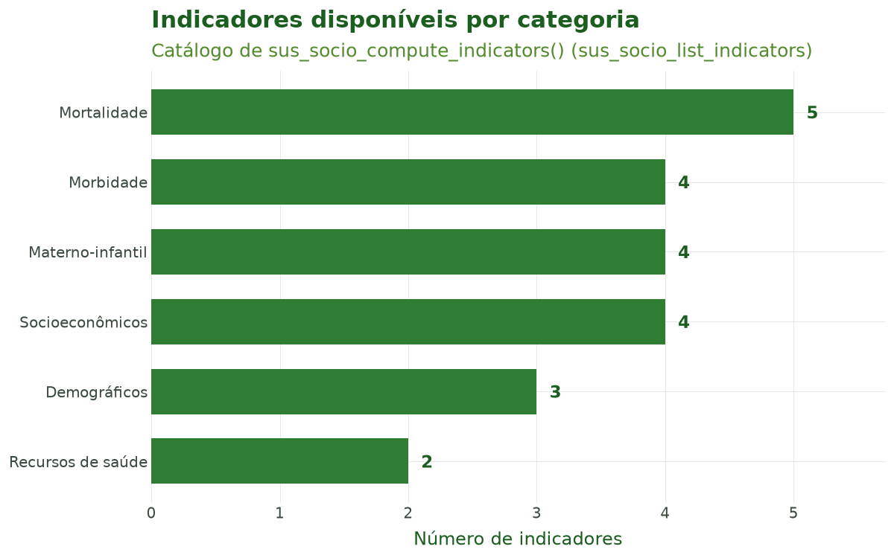
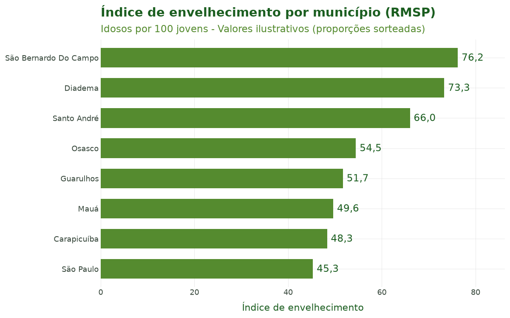
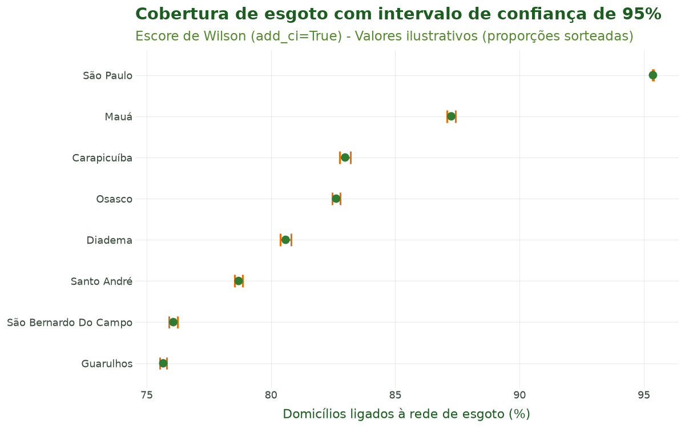
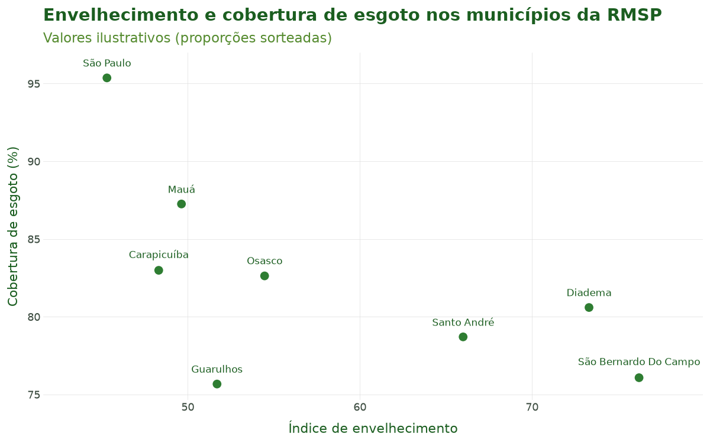

# Tutorial 6: Vínculo de Dados Socioeconômicos

[← Voltar para a Trilha do Pipeline](pipeline.md)

## Objetivo

Ao final deste tutorial você será capaz de **vincular variáveis do Censo Demográfico brasileiro
aos dados de saúde já espacializados** e **calcular indicadores socioeconômicos e
epidemiológicos padronizados**. Você aprenderá a:

- **descobrir** quais variáveis do censo existem com `sus_census_select()`;
- **vincular** o censo, já agregado por município, aos dados de saúde com `sus_census()`;
- **consultar** o catálogo completo de indicadores com `sus_socio_list_indicators()`;
- **calcular** indicadores como envelhecimento, dependência e cobertura de saneamento — com
  **intervalos de confiança** — usando `sus_socio_compute_indicators()`.

O vínculo socioeconômico é a **sexta etapa** do pipeline do `climasus4py`. Ela parte dos dados que
já passaram pela **junção espacial** (Tutorial 5), em que cada linha tem o seu município.

## Contexto científico

Estudos de clima e saúde raramente podem tratar a população como homogênea. A **vulnerabilidade
social** — pobreza, baixa escolaridade, saneamento precário, estrutura etária envelhecida —
modula a relação entre exposição ambiental (temperatura, poluição) e desfechos de saúde, atuando
tanto como **confundidor** quanto como **modificador de efeito** (Gouveia, Hajat & Armstrong,
2003; Hajat, O'Connor & Kosatsky, 2010). Idosos em domicílios sem infraestrutura adequada, por
exemplo, sofrem mais durante ondas de calor.

No Brasil, a fonte oficial dessas variáveis é o **Censo Demográfico** do IBGE, distribuído em
formato aberto pelo projeto `censobr` (Pereira & Barbosa, 2023). O `climasus4py` usa o Censo 2010
já **agregado por município** a partir desses microdados e guardado no pacote `climasus-data`:
`sus_census()` só precisa ligar essa tabela aos dados de saúde pelo código do município.

A partir das variáveis do censo, `sus_socio_compute_indicators()` calcula um conjunto de
**indicadores padronizados** (demográficos, socioeconômicos, de mortalidade, morbidade, saúde
materno-infantil e recursos de saúde), cada um com sua **fórmula**, **multiplicador** e **método
de incerteza** declarados em um catálogo interno.

**Aviso metodológico (viés ecológico).** Indicadores municipais descrevem o *agregado*, não o
indivíduo: associações observadas entre a vulnerabilidade média de um município e seus desfechos
de saúde **não** se transferem automaticamente para pessoas (falácia ecológica). A **escala de
agregação** também importa — o mesmo fenômeno pode mudar de sinal conforme a unidade (problema da
unidade de área modificável, MAUP). Use estes indicadores como covariáveis de área, não como
atributos individuais.

**Caso condutor.** Investigamos a **temperatura e os desfechos de saúde em idosos (60+) na Região
Metropolitana de São Paulo, 2014–2019**. No Tutorial 5 ligamos a série de óbitos respiratórios aos
oito municípios da RMSP. Aqui vinculamos o **Censo 2010** e calculamos indicadores de
vulnerabilidade (envelhecimento, dependência, cobertura de esgoto e de água) que servirão de
**covariáveis e modificadores de efeito** na modelagem clima–saúde dos próximos tutoriais.

## Dados utilizados

| Item | Valor | Papel no caso |
|---|---|---|
| Entrada | `caso_espacial` (Tutorial 5) | Óbitos respiratórios de idosos por mês e município (RMSP) |
| Censo | Censo 2010, agregado por município (`climasus-data`) | População de cada município |
| Chave de vínculo | Código do município (6 dígitos) | Liga saúde × censo |
| Indicadores | Envelhecimento, dependência, esgoto, água | Vulnerabilidade municipal |

**Atenção: os quatro indicadores usam valores ilustrativos.** O Censo agregado traz, para cada
município, a população e somas de variáveis dos microdados (idades, rendas…), mas não as
**contagens** que esses indicadores exigem: quantos idosos, jovens e pessoas em idade ativa, e
quantos domicílios estão ligados à rede de esgoto e de água. Por isso, no Passo 4, essas contagens
são **sorteadas** em torno da população real de cada município, apenas para mostrar como a função
funciona. Os números dos indicadores (Tabela 2 e Figuras 2 a 4) **não** descrevem a RMSP; a
população da Tabela 2 é a real do Censo 2010.

## Pipeline completo

Os blocos abaixo reproduzem o que o script
[`tools/tutoriais/tutorial_06_socioeconomico.py`](https://github.com/climasus/climasus4py/blob/main/tools/tutoriais/tutorial_06_socioeconomico.py)
executa. Comece carregando o pacote e refazendo, a partir do cache, os passos dos tutoriais
anteriores:

```python
import climasus4py as cs
import numpy as np

obitos = cs.sus_data_import(system="SIM-DO", uf="SP", year=[2014, 2015, 2016, 2017, 2018, 2019])
obitos_limpo = cs.sus_data_clean_encoding(obitos)
obitos_padr = cs.sus_data_standardize(obitos_limpo, lang="pt")

RMSP = ["São Paulo", "Guarulhos", "São Bernardo do Campo", "Santo André",
        "Osasco", "Mauá", "Carapicuíba", "Diadema"]
resp_idosos = cs.sus_filter(obitos_padr, groups="respiratory", age_min=60, city=RMSP)

obitos_vars = cs.sus_data_create_variables(
    resp_idosos,
    age_breaks=[60, 70, 80, 999],
    age_labels=["60-69", "70-79", "80+"],
    climate_region="sudeste",
    lang="pt",
)

serie = cs.sus_data_aggregate(
    obitos_vars,
    time_unit="month",
    group_by=["faixa_etaria"],
    join_col="residencia",
    lang="pt",
)

caso_espacial = cs.sus_spatial_join(serie, geo_level="municipality", join_col="residencia", lang="pt")
```

### Passo 1 — Descobrir variáveis do censo (`sus_census_select()`)

Antes de vincular o censo, vale **conhecer as variáveis** que ele tem. Em uso interativo,
`output="browser"` abre uma interface HTML pesquisável; em scripts, prefira `output="codes"`, que
**retorna a lista de códigos** sem abrir o navegador:

```python
codigos = cs.sus_census_select(
    dataset="population",  # "all", "population", "households", "families", ...
    year=2010,             # Censo 2010
    output="codes",        # "browser" (padrão), "console" ou "codes"
    lang="pt",
    verbose=False,
)
codigos[:6]
```

### Passo 2 — Vincular o censo (`sus_census()`)

`sus_census()` acrescenta a cada linha as variáveis do Censo do seu município. Informe o ano do
censo em `year` e, em `variables`, as colunas que quer trazer — aqui, a população estimada
(`sample_weight_sum`, a soma dos pesos amostrais) e o número de pessoas entrevistadas na amostra
(`n_records`):

```python
caso_censo = cs.sus_census(
    caso_espacial,
    year=2010,
    variables=["sample_weight_sum", "n_records"],
)
```

O número de linhas não muda: o censo é ligado pelo código do município, e cada linha de saúde
recebe os valores do seu município.

### Passo 3 — Consultar o catálogo de indicadores (`sus_socio_list_indicators()`)

Antes de calcular, inspecione o que está disponível. A função não depende de internet e retorna
uma tabela com `id`, `name`, `category`, `required_cols`, `formula`, `multiplier`, `unit`,
`uncertainty_method` e `source`:

```python
catalogo = cs.sus_socio_list_indicators(lang="pt")

# Filtrar por categoria, se desejar:
cs.sus_socio_list_indicators(lang="pt", category="mortality")
```

### Passo 4 — Calcular indicadores (`sus_socio_compute_indicators()`)

Os indicadores são definidos em **nomes de fórmula** (como `pop_elderly`, `total_hh`). Quando as
colunas dos seus dados têm outros nomes, use `col_mapping` para **ligar** cada nome de fórmula à
coluna real.

Como o Censo agregado não traz as contagens desses quatro indicadores (veja o aviso em *Dados
utilizados*), montamos uma tabela com uma linha por município e **sorteamos** as contagens em
torno da população real:

```python
# Uma linha por município, com a população real do Censo 2010
censo = caso_censo.df()
municipios = censo.drop_duplicates("code_muni_7")[["code_muni_7", "spatial_name", "sample_weight_sum"]]
municipios = municipios.reset_index(drop=True)
populacao = municipios["sample_weight_sum"]

# Contagens ILUSTRATIVAS: proporções sorteadas em torno da população real
sorteio = np.random.default_rng(2026)
n = len(municipios)
municipios["idosos"] = (populacao * sorteio.uniform(0.09, 0.16, n)).round()
municipios["jovens"] = (populacao * sorteio.uniform(0.16, 0.24, n)).round()
municipios["ativos"] = populacao - municipios["idosos"] - municipios["jovens"]
municipios["domicilios"] = (populacao / sorteio.uniform(2.8, 3.4, n)).round()
municipios["domicilios_esgoto"] = (municipios["domicilios"] * sorteio.uniform(0.70, 0.99, n)).round()
municipios["domicilios_agua"] = (municipios["domicilios"] * sorteio.uniform(0.85, 0.99, n)).round()

caso_socio = cs.sus_socio_compute_indicators(
    municipios,
    indicators=["aging_index", "dependency_ratio",
                "sewage_connection_rate", "water_connection_rate"],
    col_mapping={
        "pop_elderly": "idosos",           # nome de fórmula -> coluna real
        "pop_young": "jovens",
        "pop_working": "ativos",
        "total_hh": "domicilios",
        "hh_sewage": "domicilios_esgoto",
        "hh_water": "domicilios_agua",
    },
    confidence_level=0.95,  # IC de Poisson (taxas) / Wilson (proporções)
    add_ci=True,            # adiciona as colunas ind_<id>_low / ind_<id>_high
    lang="pt",
)
```

Cada indicador calculado vira uma coluna `ind_<id>` (ex.: `ind_aging_index`) e — quando o método
de incerteza não é `"none"` e `add_ci=True` — também `ind_<id>_low` e `ind_<id>_high`. Se
`indicators` não for informado, a função **detecta automaticamente** todos os indicadores cujas
colunas exigidas estão presentes (depois do `col_mapping`); indicadores sem as colunas necessárias
são **pulados com aviso**.

Ao final desta etapa temos `caso_censo` — a série de saúde com as variáveis do Censo — e
`caso_socio`, os indicadores por município.

## Características das funções

### `sus_census_select()`

Explorador das variáveis do censo.

| Argumento | Essencial? | Descrição |
|---|---|---|
| `dataset` | recomendado | `"all"` (padrão), `"population"`, `"households"`, `"families"`, `"mortality"` ou `"emigration"` |
| `year` | opcional | `2010` (padrão) |
| `output` | recomendado | `"browser"` (HTML interativo, padrão), `"console"` ou `"codes"` (lista) |
| `lang` | opcional | `"pt"` (padrão), `"en"`, `"es"` |
| `verbose` | opcional | Mensagens informativas |

**Retorno:** com `"codes"`, uma lista com os códigos das variáveis; com `"browser"` ou
`"console"`, uma tabela com código, nome, conjunto de dados, tipo e categoria de cada variável
(além de abrir ou imprimir a interface).

### `sus_census()`

Liga as variáveis do Censo, agregadas por município, aos dados de saúde.

| Argumento | Essencial? | Descrição |
|---|---|---|
| `rel` | sim | Dados de saúde com uma coluna de código municipal (agregados ou já com geometria) |
| `year` | recomendado | Ano do censo. Sem ele, usa o mais recente instalado — o Censo 2022, que traz só população e coordenadas — e avisa |
| `variables` | recomendado | Colunas do censo a trazer; sem ele, traz todas |
| `census` | opcional | Uma tabela de censo própria, com a coluna `municipality_code`, no lugar da do `climasus-data` |

**Retorno:** os dados de saúde com as colunas do censo e o estágio `census` registrado. As
variáveis do Censo 2010 são a **soma** de cada variável dos microdados por município (por isso o
sufixo `_sum`); `sample_weight_sum`, a soma dos pesos amostrais, é a população estimada.

### `sus_socio_compute_indicators()`

Calcula indicadores padronizados sobre as colunas presentes, com intervalos de confiança
opcionais.

| Argumento | Essencial? | Descrição |
|---|---|---|
| `df` | sim | Tabela com as colunas que os indicadores exigem (por exemplo, a saída de `sus_census()`) |
| `indicators` | opcional | Lista de IDs; sem ela, calcula todos os que as colunas permitem |
| `col_mapping` | recomendado | Dicionário: nome de fórmula → coluna real (ex.: `{"total_hh": "domicilios"}`) |
| `confidence_level` | opcional | Nível de confiança (padrão `0.95`) |
| `add_ci` | opcional | `True` (padrão) adiciona `ind_<id>_low` e `ind_<id>_high` |
| `lang` / `verbose` | opcional | Idioma e mensagens |

**Retorno:** os dados com as colunas `ind_<id>` (e `_low`/`_high` quando houver intervalo) e o
tipo `indicators` registrado em `attrs["sus_meta"]`. Cada indicador é uma razão multiplicada pelo
`multiplier` do catálogo (por exemplo, idosos ÷ jovens × 100 no índice de envelhecimento). Os
intervalos de confiança seguem o `uncertainty_method`: **Poisson exato** para taxas de eventos
(mortalidade, incidência, internações), **escore de Wilson** para proporções (coberturas) e nenhum
para razões compostas e índices diretos (como dependência e Gini).

### `sus_socio_list_indicators()`

Lista o catálogo completo de indicadores. **Não depende de internet.**

| Argumento | Descrição |
|---|---|
| `lang` | Idioma dos nomes: `"pt"` (padrão), `"en"`, `"es"` |
| `category` | Filtra por categoria (ex.: `"demographic"`, `"mortality"`); sem ela, todas |

**Retorno:** uma tabela com `id`, `name`, `category`, `required_cols`, `formula`, `multiplier`,
`unit`, `uncertainty_method` e `source`.

## Resultados ilustrados

**Tabela 1.** Amostra do catálogo de indicadores (`sus_socio_list_indicators()`): os quatro do
caso condutor e outros quatro de categorias diferentes.

| id | Nome | Categoria | Fórmula | Multiplicador | Incerteza |
|---|---|---|---|---|---|
| `aging_index` | Índice de Envelhecimento | Demográficos | `pop_elderly / pop_young` | 100 | none |
| `dependency_ratio` | Razão de Dependência | Demográficos | `(pop_young + pop_elderly) / pop_working` | 100 | none |
| `sewage_connection_rate` | Cobertura de Esgoto | Socioeconômicos | `hh_sewage / total_hh` | 100 | binomial |
| `water_connection_rate` | Cobertura de Água Encanada | Socioeconômicos | `hh_water / total_hh` | 100 | binomial |
| `urbanization_rate` | Taxa de Urbanização | Demográficos | `pop_urban / pop_total` | 100 | binomial |
| `homicide_rate` | Taxa de Homicídios | Mortalidade | `deaths_homicide / pop_total` | 100.000 | poisson |
| `respiratory_hospitalization_rate` | Taxa de Internações Respiratórias | Morbidade | `hosp_resp / pop_total` | 10.000 | poisson |
| `beds_per_capita` | Leitos por Mil Habitantes | Recursos de saúde | `cnes_beds / pop_total` | 1.000 | none |



**Figura 1.** Número de indicadores disponíveis por categoria no catálogo de
`sus_socio_compute_indicators()` — 22 ao todo. As categorias cobrem demografia, vulnerabilidade
socioeconômica, mortalidade, morbidade, saúde materno-infantil e recursos de saúde.

**Tabela 2.** Indicadores calculados por município, do mais ao menos envelhecido. A população é a
real do Censo 2010; os indicadores são **ilustrativos** (contagens sorteadas, veja *Dados
utilizados*).

| Município | População (Censo 2010) | Envelhecimento | Dependência | Esgoto (%) | IC 95% esgoto | Água (%) |
|---|---|---|---|---|---|---|
| São Bernardo Do Campo | 765.463 | 76,2 | 54,9 | 76,1 | 75,90–76,24 | 97,6 |
| Diadema | 386.089 | 73,3 | 46,8 | 80,6 | 80,37–80,81 | 93,5 |
| Santo André | 676.407 | 66,0 | 57,6 | 78,7 | 78,53–78,87 | 91,1 |
| Osasco | 666.740 | 54,5 | 48,3 | 82,6 | 82,46–82,78 | 92,9 |
| Guarulhos | 1.221.979 | 51,7 | 56,3 | 75,7 | 75,54–75,80 | 89,8 |
| Mauá | 417.064 | 49,6 | 53,7 | 87,3 | 87,08–87,42 | 98,3 |
| Carapicuíba | 369.584 | 48,3 | 45,9 | 83,0 | 82,77–83,19 | 96,2 |
| São Paulo | 11.253.503 | 45,3 | 48,9 | 95,4 | 95,34–95,38 | 89,5 |



**Figura 2.** Ranking municipal pelo índice de envelhecimento (idosos por 100 jovens), com valores
ilustrativos. Com dados reais, municípios mais envelhecidos tendem a concentrar maior risco frente
a extremos de temperatura.



**Figura 3.** Cobertura de esgoto por município com intervalo de confiança de 95% (escore de
Wilson), como produzido por `add_ci=True`, com valores ilustrativos. A barra de erro comunica a
incerteza da proporção; com centenas de milhares de domicílios no denominador, o intervalo fica
muito estreito.



**Figura 4.** Relação entre envelhecimento e cobertura de esgoto nos municípios da RMSP, com
valores ilustrativos. Com dados reais, cruzar vulnerabilidade demográfica e de infraestrutura
ajuda a levantar hipóteses de confundimento e modificação de efeito na relação temperatura–saúde
dos próximos tutoriais.

## Referências

- Pereira, R. H. M., & Barbosa, R. J. (2023). *censobr: Download Data from Brazil's Population
  Census.* R package version 0.4.0. <https://CRAN.R-project.org/package=censobr>. DOI:
  10.32614/CRAN.package.censobr.
- Gouveia, N., Hajat, S., & Armstrong, B. (2003). Socioeconomic differentials in the
  temperature–mortality relationship in São Paulo, Brazil. *International Journal of
  Epidemiology*, 32(3), 390–397.
- Hajat, S., O'Connor, M., & Kosatsky, T. (2010). Health effects of hot weather: from awareness of
  risk factors to effective health protection. *The Lancet*, 375(9717), 856–863.
- IBGE — Instituto Brasileiro de Geografia e Estatística. *Censo Demográfico 2010.* Rio de
  Janeiro: IBGE.

## Navegação

- [Voltar para a Trilha do Pipeline](pipeline.md)
- **Anterior:** [Tutorial 5 — Junção Espacial](05-juncao-espacial.md)
- **Próximo:** [Tutorial 7 — Clima por Estações (INMET)](07-clima-estacoes.md)
