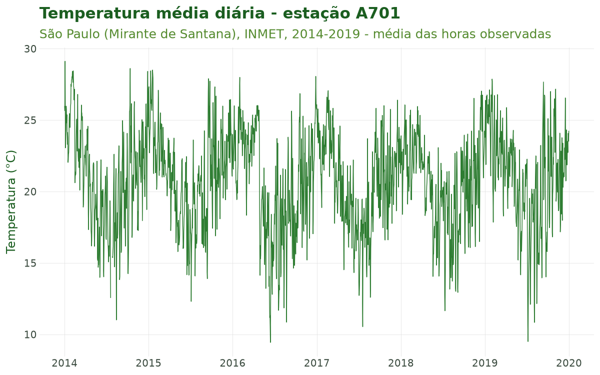
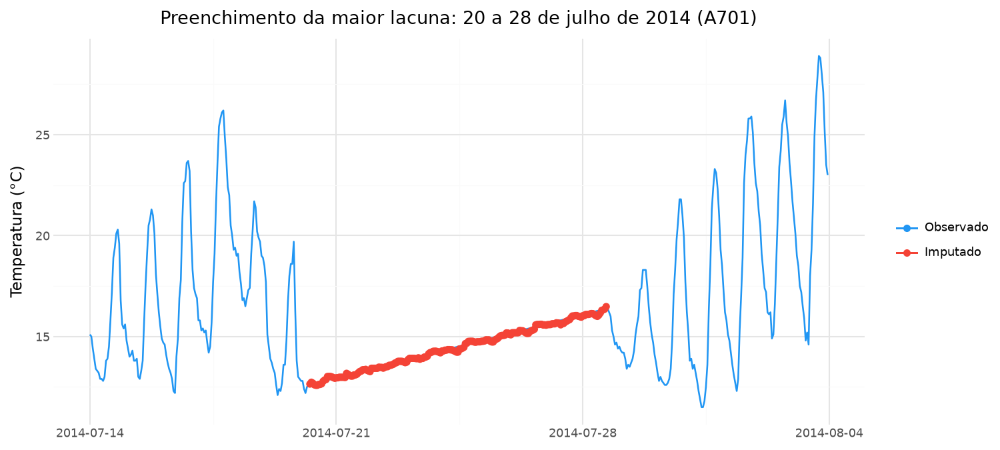
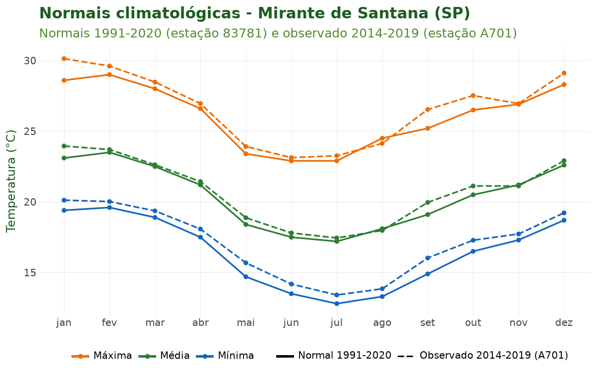
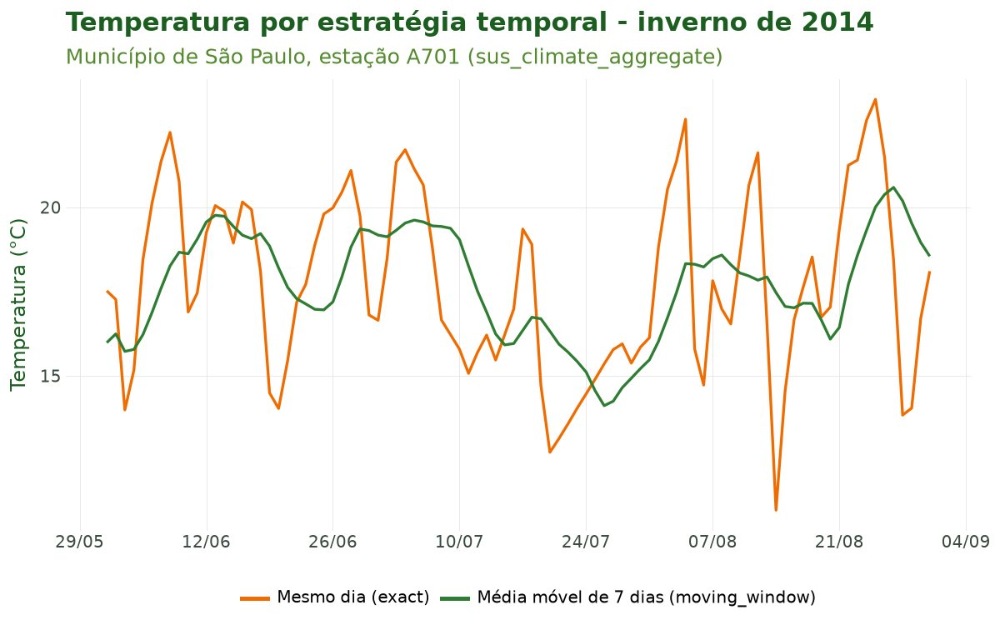

# Tutorial 7: Integração Climática por Estações (INMET)

[← Voltar para a Trilha do Pipeline](pipeline.md)

## Objetivo

Ao final deste tutorial você será capaz de **trazer a dimensão climática observada para o
pipeline** usando dados das estações meteorológicas do **Instituto Nacional de Meteorologia
(INMET)**. Especificamente, você aprenderá a:

1. **Importar** a série horária de uma estação com `sus_climate_inmet()`;
2. **Preencher lacunas** da série com modelos de aprendizado de máquina (XGBoost) por estação,
   com `sus_climate_fill_inmet()`;
3. **Visualizar** o resultado do preenchimento (observado vs imputado) com
   `sus_climate_plot_fill()`;
4. **Consultar as normais climatológicas** de 30 anos com `sus_climate_normals()`, que servem de
   linha de base climatológica;
5. **Alinhar** a série climática à série de saúde usando estratégias temporais
   epidemiologicamente fundamentadas (mesmo dia, defasagem, janela móvel...) com
   `sus_climate_aggregate()`.

Esta é a **sétima etapa** do pipeline (estágio `climate`). Ela conecta a série de saúde ao clima
observado, produzindo a base exposição × desfecho que alimentará a etapa de clima em grade
(Tutorial 8) e a modelagem (Tutorial 9).

## Contexto científico

A epidemiologia ambiental relaciona **exposições climáticas** a **desfechos de saúde**. No Brasil,
as estações automáticas do INMET fornecem observações horárias de temperatura, umidade,
precipitação, pressão e vento, com cobertura nacional crescente desde os anos 2000. Diferentemente
de produtos de reanálise em grade (Tutorial 8), os dados de estação medem o ambiente *in situ*, com
alta resolução temporal, mas com **representatividade espacial limitada** ao entorno da estação
(Saldanha et al., 2019; Geirinhas et al., 2018).

Três desafios metodológicos atravessam esta etapa:

- **Qualidade e lacunas.** Sensores falham; séries têm valores faltantes e inconsistências
  físicas. O preenchimento por modelos como o XGBoost (Chen & Guestrin, 2016) recupera lacunas a
  partir de padrões temporais (defasagens, ciclos diário e sazonal) e funciona bem em lacunas
  curtas. Em lacunas longas, de vários dias, o modelo fica sem as horas vizinhas em que se apoia —
  por isso vale **olhar o tamanho das lacunas** antes de confiar no preenchimento (Figura 2).
- **Linha de base climatológica.** As **normais climatológicas** (médias de 30 anos) definem o
  clima de referência de cada local — essencial para contextualizar anomalias e definir o ponto de
  referência de modelos de resposta dose-exposição (Gasparrini, 2011).
- **Alinhamento temporal causal.** O efeito do calor ou do frio sobre a saúde raramente é
  instantâneo: há **defasagens** (efeitos retardados) e **acúmulo** (exposição cumulativa). A
  escolha da estratégia temporal deve refletir o mecanismo biológico hipotetizado (Bhaskaran et
  al., 2013; Gasparrini et al., 2010), e jamais usar o clima *futuro* para explicar um evento
  presente (viés de antecipação).

**Caso condutor.** Investigamos **temperatura e desfechos de saúde em idosos (60+) na Região
Metropolitana de São Paulo (RMSP), 2014–2019**. Nesta etapa, importamos a série da estação de
referência da RMSP — **São Paulo – Mirante de Santana (código A701)** —, preenchemos suas lacunas,
consultamos as normais e **alinhamos a temperatura à série diária de óbitos respiratórios** dos
oito municípios do caso.

## Dados utilizados

| Fonte | Função | Papel no caso |
|---|---|---|
| Série horária INMET, estação A701 (RMSP), 2014–2019 | `sus_climate_inmet()` | Exposição climática observada |
| Série A701 com lacunas preenchidas (XGBoost) | `sus_climate_fill_inmet()` | Série contínua de temperatura |
| Normais climatológicas 1991–2020 | `sus_climate_normals()` | Linha de base climatológica |
| Série diária de óbitos respiratórios de idosos (Tutoriais 1 a 5) | `sus_climate_aggregate()` | Desfecho a ser alinhado |

Todos os dados são **públicos e reais** (INMET e DATASUS).

## Pipeline completo

Os blocos abaixo reproduzem o que o script
[`tools/tutoriais/tutorial_07_clima_estacoes.py`](https://github.com/climasus/climasus4py/blob/main/tools/tutoriais/tutorial_07_clima_estacoes.py)
executa. Carregue o pacote:

```python
import climasus4py as cs
```

### Importar a série da estação (A701)

`sus_climate_inmet()` baixa os dados horários do INMET (um arquivo por ano, guardado em cache),
padroniza os nomes das colunas para nomes canônicos (ex.: `tair_dry_bulb_c`, `rh_mean_porc`,
`rainfall_mm`) e aplica controle de qualidade físico. Filtramos pela estação de referência da RMSP
via `station_code`:

```python
clima_horario = cs.sus_climate_inmet(
    years=[2014, 2015, 2016, 2017, 2018, 2019],
    uf="SP",
    station_code="A701",    # São Paulo - Mirante de Santana
    use_cache=True,         # guarda os arquivos baixados e já lidos
    lang="pt",
)
clima_df = clima_horario.df()
```

O retorno tem frequência **horária**, com datas em **UTC** (horário de Brasília + 3 h). Como as
próximas funções trabalham com tabelas do pandas, materializamos a série com `.df()`.

### Preencher lacunas com XGBoost

`sus_climate_fill_inmet()` ajusta um modelo XGBoost **por estação e por variável**, criando
automaticamente atributos temporais (hora, dia, mês, transformações cíclicas), defasagens e
estatísticas móveis. Primeiro avaliamos a acurácia (modo avaliação), depois preenchemos de fato
(modo produção):

```python
# Modo AVALIAÇÃO: esconde 20% das horas observadas e mede o erro ao recuperá-las
aval = cs.sus_climate_fill_inmet(
    clima_df,
    target_var="tair_dry_bulb_c",
    quality_threshold=0.4,    # exclui estações com mais de 40% de faltantes
    run_evaluation=True,
    gap_percentage=0.2,       # 20% de lacunas artificiais
    lang="pt",
)
aval["tair_dry_bulb_c"]["metrics"]   # MAE, RMSE, R² e número de horas avaliadas
```

```python
# Modo PRODUÇÃO: preenche as lacunas reais e adiciona a coluna is_imputed_<variável>
clima_preenchido = cs.sus_climate_fill_inmet(
    clima_df,
    target_var="tair_dry_bulb_c",
    quality_threshold=0.4,
    run_evaluation=False,
    keep_features=False,      # devolve só as colunas originais + a marcação
    lang="pt",
)
```

Para imputar **todas** as variáveis canônicas do INMET de uma vez, use `target_var="all"`.

### Visualizar o preenchimento

`sus_climate_plot_fill()` desenha a série observada com os pontos imputados destacados. Para ver
uma lacuna de perto, passe só o trecho que interessa — aqui, as três semanas em torno da maior
lacuna da A701:

```python
# Série inteira
cs.sus_climate_plot_fill(clima_preenchido, clima_df, target_var="tair_dry_bulb_c", lang="pt")

# Aproximando a maior lacuna (20 a 28 de julho de 2014)
inicio, fim = "2014-07-14", "2014-08-04"
trecho_preenchido = clima_preenchido[(clima_preenchido["date"] >= inicio) & (clima_preenchido["date"] < fim)]
trecho_original = clima_df[(clima_df["date"] >= inicio) & (clima_df["date"] < fim)]
cs.sus_climate_plot_fill(trecho_preenchido, trecho_original, target_var="tair_dry_bulb_c", lang="pt")
```

### Consultar as normais climatológicas

`sus_climate_normals()` baixa as normais de 30 anos do INMET. Escolhemos o período mais recente e
as variáveis de temperatura. As normais são publicadas para as **estações convencionais**, que têm
código numérico: o Mirante de Santana é a **83781** (a A701 é a estação automática do mesmo local).

```python
normais = cs.sus_climate_normals(
    period="1991-2020",                          # ou "1961-1990", "1981-2010"
    target_var=["t_max", "t_min", "t_mean_comp"],
    use_cache=True,
    lang="pt",
)
mirante = normais[normais["codigo"] == "83781"]

# Para explorar os códigos de variável disponíveis antes:
# cs.sus_climate_normals_meta(period="1991-2020", lang="pt")
```

### Alinhar clima e saúde (estratégias temporais)

`sus_climate_aggregate()` liga cada registro de saúde à estação mais próxima e aplica a estratégia
temporal escolhida. Ela recebe a série de saúde **já com o município espacializado** (saída de
`sus_spatial_join()`, Tutorial 5). Montamos a série diária de óbitos respiratórios de idosos pelo
município de **residência** — o lugar a cujo clima a pessoa estava exposta:

```python
# Série de saúde: os passos dos Tutoriais 1 a 5, agora com contagem diária
obitos = cs.sus_data_import(system="SIM-DO", uf="SP", year=[2014, 2015, 2016, 2017, 2018, 2019])
obitos_limpo = cs.sus_data_clean_encoding(obitos)
obitos_padr = cs.sus_data_standardize(obitos_limpo, lang="pt")

RMSP = ["São Paulo", "Guarulhos", "São Bernardo do Campo", "Santo André",
        "Osasco", "Mauá", "Carapicuíba", "Diadema"]
resp_idosos = cs.sus_filter(obitos_padr, groups="respiratory", age_min=60, city=RMSP)
obitos_vars = cs.sus_data_create_variables(
    resp_idosos,
    age_breaks=[60, 70, 80, 999],
    age_labels=["60-69", "70-79", "80+"],
    climate_region="sudeste",
    lang="pt",
)

serie_diaria = cs.sus_data_aggregate(obitos_vars, time_unit="day", join_col="residencia", lang="pt")
saude_espacial = cs.sus_spatial_join(serie_diaria, geo_level="municipality", join_col="residencia", lang="pt")
```

Aqui a série é montada sem `complete_dates=True`: com essa opção, `sus_data_aggregate()` devolve
uma tabela do pandas, que `sus_spatial_join()` não aceita. Os dias sem óbito ficam de fora da
série, o que não muda o alinhamento dos dias com óbito.

Comparamos a exposição do **mesmo dia** (`exact`) com a **janela móvel de 7 dias**
(`moving_window`, recomendada para exposição cumulativa):

```python
# Exposição aguda (mesmo dia)
saude_exact = cs.sus_climate_aggregate(
    saude_espacial,
    clima_preenchido,
    temporal_strategy="exact",
    climate_vars=["tair_dry_bulb_c"],
)

# Exposição cumulativa (média móvel retroativa de 7 dias: t-6 .. t)
saude_movel = cs.sus_climate_aggregate(
    saude_espacial,
    clima_preenchido,
    temporal_strategy="moving_window",
    window_days=7,
    climate_vars=["tair_dry_bulb_c"],
)
```

Com `exact`, cada dia recebe a média diária da temperatura (`tair_dry_bulb_c`); com
`moving_window`, recebe também a média dos 7 dias até ele (`tair_dry_bulb_c_mean_w7`). Os
primeiros dias de 2014 ficam sem a média móvel, porque a janela pediria dias de 2013, que não foram
importados. Como só importamos a A701, os oito municípios recebem o clima dessa estação.

Ao final desta etapa temos `saude_exact` e `saude_movel` — a série de saúde com a temperatura
alinhada, base para o Tutorial 8.

## Características das funções

### `sus_climate_inmet()`

Importa, padroniza e controla a qualidade dos dados horários do INMET.

| Argumento | Essencial? | Descrição |
|---|---|---|
| `years` | recomendado | Ano(s), de 2000 ao ano atual (ex.: `[2014, 2015]`); sem ele, usa os 2 últimos |
| `uf` | recomendado | UF(s) (`"SP"`, `["RJ", "MG"]`); sem ela, baixa as 27 UFs |
| `station_code` | opcional | Filtra estações por código (`"A701"`); sem ele, todas da UF |
| `use_cache` / `cache_dir` | recomendado | Guarda os arquivos baixados e os anos já lidos (padrão `~/.climasus4py_cache/climate`) |
| `parallel` / `workers` | opcional | Processa os anos em paralelo |
| `lang` / `verbose` | opcional | Idioma (`"pt"`, `"en"`, `"es"`) e progresso |

**Retorno:** uma relação do DuckDB (materialize com `.df()`), frequência **horária**, datas em
**UTC**, colunas canônicas e metadados da estação (nome, código, coordenadas, data de fundação).
**Controle de qualidade automático:** validação de faixas físicas e consistência do ponto de
orvalho (fórmula de Magnus).

### `sus_climate_fill_inmet()`

Imputa valores faltantes com XGBoost, um modelo por estação por variável.

| Argumento | Essencial? | Descrição |
|---|---|---|
| `df` | sim | Série horária do INMET (`sus_climate_inmet(...).df()`) |
| `target_var` | sim | Coluna(s) a imputar, ou `"all"` (todas as variáveis canônicas) |
| `quality_threshold` | recomendado | Máximo de faltantes por estação (padrão `0.4`) |
| `run_evaluation` | opcional | `True` cria lacunas artificiais e devolve métricas |
| `gap_percentage` | opcional | Proporção de lacunas artificiais na avaliação (padrão `0.2`) |
| `keep_features` | opcional | `True` mantém os atributos criados (defasagens, médias móveis) |
| `parallel` / `workers` | opcional | Processa estações em paralelo |
| `datetime_col` / `station_col` | opcional | Nomes das colunas; detectados se omitidos |
| `lang` / `verbose` | opcional | Idioma e mensagens |

**Retorno (produção):** a mesma tabela com `target_var` imputada e a coluna
`is_imputed_<variável>` (`True` nas horas preenchidas). **Retorno (avaliação):** um dicionário por
variável, com `["data"]` e `["metrics"]` (MAE, RMSE, R² e número de horas avaliadas, por estação).

### `sus_climate_plot_fill()`

Visualiza o preenchimento: a série observada em linha e os pontos imputados em destaque.

| Argumento | Essencial? | Descrição |
|---|---|---|
| `df_filled` | sim | Saída de `sus_climate_fill_inmet()` (modo produção) |
| `df_original` | opcional | Série antes do preenchimento |
| `target_var` | sim | Variável a visualizar |
| `station` | opcional | Código da estação; sem ele, a primeira da tabela |
| `output_type` | opcional | `"plot"` (padrão) ou `"all"` (gráfico e dados) |
| `color_palette` | opcional | Cores de observado e imputado |
| `lang` | opcional | Idioma dos rótulos |

**Retorno:** o gráfico (um objeto do plotnine), ou um dicionário com o gráfico e os dados.

### `sus_climate_normals()`

Baixa as normais climatológicas de 30 anos do INMET.

| Argumento | Essencial? | Descrição |
|---|---|---|
| `period` | recomendado | `"1961-1990"`, `"1981-2010"` ou `"1991-2020"` (padrão) |
| `target_var` | opcional | Códigos de variável (`["t_max", "t_min"]`); sem ele, todas |
| `use_cache` / `cache_dir` | recomendado | Cache em disco do catálogo e dos arquivos |
| `lang` / `verbose` | opcional | Idioma e progresso |

**Retorno:** uma tabela em formato longo com `codigo`, `nome_estacao`, `uf`, `mes`, `decada`,
`valor`, `var_code` e rótulos em três idiomas. Companheira: `sus_climate_normals_meta()` lista os
códigos de variável disponíveis.

### `sus_climate_aggregate()`

Liga o clima à saúde pela estação mais próxima e aplica a estratégia temporal.

| Argumento | Essencial? | Descrição |
|---|---|---|
| `health_data` | sim | Série de saúde com o município espacializado (saída de `sus_spatial_join()`) |
| `climate_data` | sim | Série climática (saída de `sus_climate_fill_inmet()` ou de `sus_climate_inmet()`) |
| `climate_vars` | recomendado | Variável(is) climática(s); `"all"` (padrão) |
| `temporal_strategy` | sim | Uma das 10 estratégias (veja abaixo) |
| `window_days` | condicional | Tamanho da janela (móvel, graus-dia, limiar, ponderada) |
| `lag_days` | condicional | Defasagem(ns) para `discrete_lag` / máxima para `distributed_lag` |
| `offset_days` | condicional | `[W1, W2]` para `offset_window` |
| `temp_base` / `gdd_temp_var` | condicional | Base térmica e variável para `degree_days` |
| `threshold_value` / `threshold_direction` | condicional | Limiar para `*_exceedance` |
| `climate_region` | opcional | `"auto"` (padrão), `"tropical"`, `"subtropical"`, `"temperate"` |
| `min_obs` | opcional | Proporção mínima de observações válidas na janela (padrão `0.7`) |
| `max_distance_km` | opcional | Distância máxima entre município e estação |

**Estratégias temporais (`temporal_strategy`):** `exact`, `discrete_lag`, `moving_window`,
`offset_window`, `distributed_lag`, `degree_days`, `seasonal`, `threshold_exceedance`,
`cold_wave_exceedance`, `weighted_window`. Todas olham só para o passado do evento: a média móvel
de 7 dias do dia *t* usa os dias *t*−6 a *t*.

**Retorno:** uma relação do DuckDB com os dados de saúde e as variáveis climáticas como novas
colunas.

## Resultados ilustrados



**Figura 1.** Temperatura média diária observada na estação A701 (São Paulo – Mirante de Santana),
2014–2019. A sazonalidade de inverno (menores temperaturas entre junho e agosto) é nítida e será o
eixo do alinhamento com a mortalidade de idosos.

**Tabela 1.** Cobertura e lacunas da série importada (antes do preenchimento).

| Item | Valor |
|---|---|
| Estação | A701 — São Paulo (Mirante de Santana) |
| Período | 01/01/2014 a 31/12/2019 |
| Horas na série | 52.584 |
| Horas sem temperatura | 344 (0,65%) |
| Lacunas (trechos contínuos) | 6 |
| Maior lacuna | 203 h (cerca de 8,5 dias), a partir de 20/07/2014 |



**Figura 2.** A maior lacuna da A701, aproximada com `sus_climate_plot_fill()`: 203 horas, de 20 a
28 de julho de 2014. Nos dias observados em volta, a temperatura sobe e desce de 5 °C a 13 °C entre
a noite e a tarde; dentro da lacuna, o valor imputado sobe quase em linha reta de 12 °C para 16 °C,
sem o ciclo diário. É o limite do método: sem horas vizinhas observadas, o modelo não tem de onde
tirar a oscilação do dia. Em lacunas curtas (Tabela 2), o erro é pequeno; em lacunas de vários
dias, prefira marcar os dias preenchidos (`is_imputed_tair_dry_bulb_c`) e avaliar se devem entrar
na análise.

**Tabela 2.** Métricas de avaliação do preenchimento (20% das horas observadas escondidas ao acaso e
recuperadas pelo modelo).

| Estação | MAE (°C) | RMSE (°C) | R² | Horas avaliadas |
|---|---|---|---|---|
| A701 | 0,54 | 0,88 | 0,962 | 10.448 |



**Figura 3.** Ciclo anual das normais climatológicas de temperatura (1991–2020) do Mirante de
Santana (linhas cheias) e a média observada na A701 em 2014–2019 (linhas tracejadas). As normais
fornecem a linha de base contra a qual anomalias e extremos são medidos nos tutoriais seguintes: em
quase todos os meses, 2014–2019 foi mais quente que a normal, sobretudo nas mínimas e em setembro e
outubro.



**Figura 4.** Exposição à temperatura por estratégia temporal no inverno de 2014, no município de
São Paulo: o valor do **mesmo dia** (`exact`) oscila mais, enquanto a **média móvel de 7 dias**
(`moving_window`) suaviza o sinal e captura a exposição cumulativa — escolha que reflete o
mecanismo biológico de interesse no modelo final. Entre 20 e 28 de julho, o trecho reto da curva do
mesmo dia é a lacuna preenchida da Figura 2 chegando ao alinhamento.

## Referências

- Bhaskaran, K., Gasparrini, A., Hajat, S., Smeeth, L., & Armstrong, B. (2013). Time series
  regression studies in environmental epidemiology. *International Journal of Epidemiology*,
  42(4), 1187–1195.
- Chen, T., & Guestrin, C. (2016). XGBoost: A scalable tree boosting system. *Proceedings of the
  22nd ACM SIGKDD*, 785–794.
- Gasparrini, A. (2011). Distributed lag linear and non-linear models in R: the package dlnm.
  *Journal of Statistical Software*, 43(8), 1–20.
- Gasparrini, A., Armstrong, B., & Kenward, M. G. (2010). Distributed lag non-linear models.
  *Statistics in Medicine*, 29(21), 2224–2234.
- Geirinhas, J. L., et al. (2018). Climatic and synoptic characterization of heat waves in Brazil.
  *International Journal of Climatology*, 38(4), 1760–1776.
- Saldanha, R. de F., Bastos, R. R., & Barcellos, C. (2019). Microdatasus: pacote para download e
  pré-processamento de microdados do DATASUS. *Cadernos de Saúde Pública*, 35(9), e00032419.
- INMET — Instituto Nacional de Meteorologia. Dados históricos. Disponível em:
  <https://portal.inmet.gov.br/dadoshistoricos>.

## Navegação

- [Voltar para a Trilha do Pipeline](pipeline.md)
- **Anterior:** [Tutorial 6 — Vínculo Socioeconômico](06-socioeconomico.md)
- **Próximo:** Tutorial 8 — Clima em Grade e Dados Ambientais *(em preparação)*
