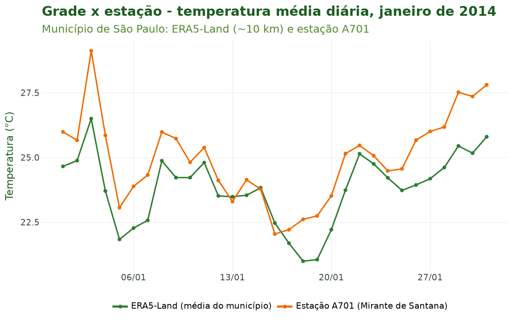
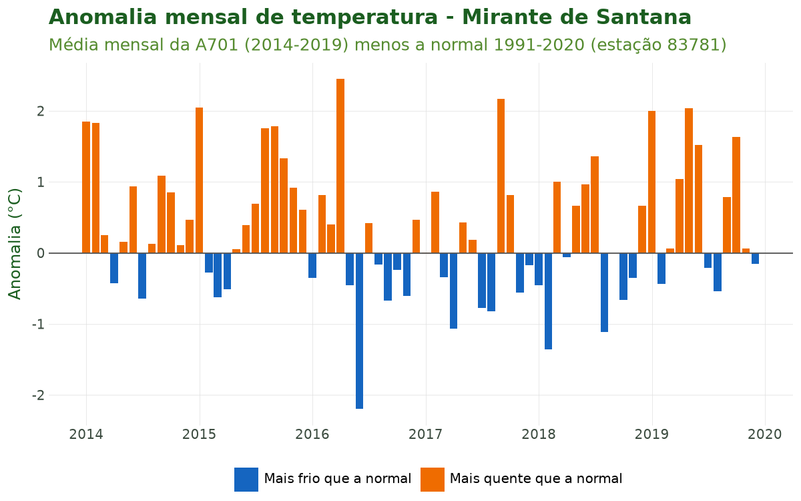
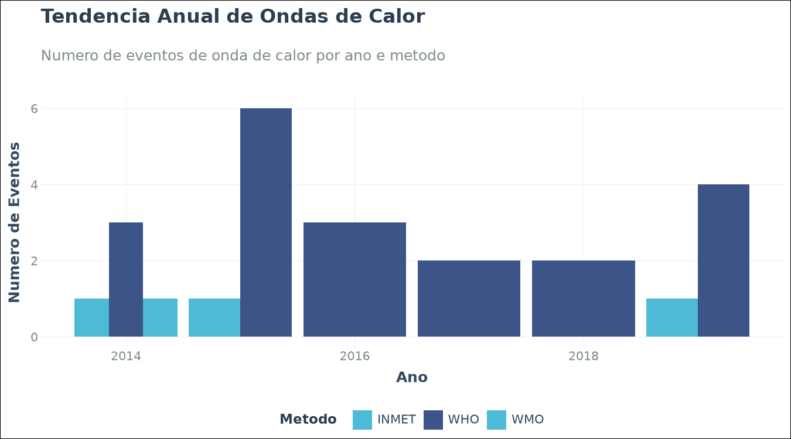
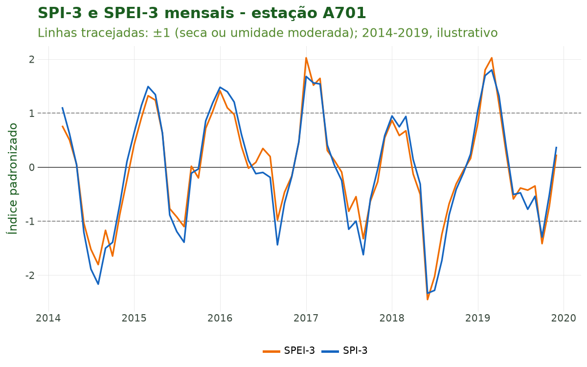

# Tutorial 8: Clima em Grade e Dados Ambientais

[← Voltar para a Trilha do Pipeline](pipeline.md)

## Objetivo

Ao final deste tutorial você será capaz de **integrar dados climáticos e ambientais em grade**
(sensoriamento remoto e reanálise) à sua série de saúde: importar o **ERA5-Land** (~10 km) com
`sus_grid_era5()` e agregá-lo ao polígono municipal; conhecer a família completa `sus_grid_*`
(precipitação CHIRPS, focos de queimada, secas PDSI/SMVI, desmatamento PRODES e poluição
CAMS/GHAP/MERRA-2); e derivar **indicadores climáticos para epidemiologia**: anomalias, índices
bioclimáticos (`sus_climate_compute_indicators()`), ondas de calor
(`sus_climate_compute_heatwaves()` + `sus_climate_plot_heatwaves()`) e os índices de seca **SPI**
(`sus_climate_compute_spi()`) e **SPEI** (`sus_climate_compute_spei()`).

Esta é a **oitava etapa** do pipeline: enquanto o Tutorial 7 construiu a exposição climática a
partir de **estações** do INMET (medições pontuais), aqui construímos uma exposição **alternativa e
complementar em grade** — cobertura espacial contínua, sem lacunas de observação — que alimentará
a modelagem do Tutorial 9.

## Contexto científico

### Estação vs. pixel: duas formas de medir a exposição

Uma estação meteorológica mede o clima em um **ponto**; um produto em grade representa o valor
**médio de um pixel** (uma célula de área fixa). O **ERA5-Land** (Muñoz-Sabater et al., 2021) é
uma **reanálise**: um modelo físico de superfície terrestre alimentado por observações, que produz
campos horários contínuos desde 1950 em resolução de ~0,1° (**~10 km** no equador). Para o Brasil,
o projeto *ERA5-Land Daily Aggregates for Latin America* (Saldanha, Zenodo, CC-BY 4.0)
disponibiliza agregados **diários** prontos, sem chave de API — é essa a fonte usada por
`sus_grid_era5()`.

Três cuidados de quem trabalha com sensoriamento remoto e reanálise:

1. **Resolução e representatividade.** Um pixel de ~10 km é uma média de área: suaviza extremos
   locais (ilhas de calor urbanas, microclimas de vale) que uma estação pontual captura. Em
   contrapartida, cobre municípios **sem estação** e não tem dados faltantes. Para um município
   extenso como São Paulo (~1.500 km²), dezenas de pixels são agregados ao polígono, com média
   **ponderada pela área** de interseção, o que evita viés de borda.
2. **Unidades físicas.** Os arquivos NetCDF originais vêm em unidades do sistema internacional:
   temperatura em **Kelvin** (K → °C: subtrair 273,15), precipitação em **metros** (m → mm:
   multiplicar por 1.000) e pressão em **Pa** (Pa → hPa: dividir por 100). `sus_grid_era5()`
   aplica essas conversões automaticamente e entrega colunas canônicas (`tair_dry_bulb_c`,
   `rainfall_mm`, ...).
3. **Validação cruzada.** Reanálise não substitui observação: o recomendado é comparar a série de
   grade com a estação do INMET mais próxima (Tutorial 7) antes de escolher a exposição do modelo
   — diferenças sistemáticas (viés) são esperadas e documentáveis. É o que fazemos na Figura 1.

### Dos campos brutos aos indicadores epidemiológicos

A literatura de clima-saúde raramente usa a temperatura bruta diretamente:

- **Anomalias** (WMO, 2017) tornam cidades com climas distintos comparáveis e apontam os períodos
  extremos a correlacionar com picos de mortalidade (Gasparrini et al., 2017);
- **Ondas de calor** definidas por percentis e duração (Perkins & Alexander, 2013; Geirinhas et
  al., 2018) e pelo *Excess Heat Factor* — EHF (Nairn & Fawcett, 2015) capturam o efeito agudo do
  calor sustentado;
- **SPI** (McKee et al., 1993) e **SPEI** (Vicente-Serrano et al., 2010) padronizam seca e umidade
  em múltiplas escalas temporais — relevantes para doenças diarreicas, leptospirose e arboviroses;
- **Índices bioclimáticos** (UTCI, Bröde et al., 2012; WBGT, Liljegren et al., 2008; HI, Rothfusz,
  1990) combinam temperatura, umidade, vento e radiação em uma única medida de estresse térmico
  humano.

**Caso condutor.** Seguimos com **temperatura e desfechos de saúde em idosos (60+) na RM de São
Paulo, 2014–2019**. Neste tutorial importamos o ERA5-Land para o município de São Paulo, comparamos
com a estação A701 e derivamos anomalias, ondas de calor e SPI/SPEI.

## Dados utilizados

| Fonte | Função | Resolução | Período | Papel no caso |
|---|---|---|---|---|
| ERA5-Land (Zenodo) | `sus_grid_era5()` | ~10 km, diária | janeiro de 2014 | Exposição em grade e comparação com a estação |
| Estação A701 (INMET) | `sus_climate_inmet()` | ponto, horária | 2014–2019 | Base dos índices (anomalia, ondas de calor, SPI/SPEI) |
| Normais 1991–2020 (estação 83781) | `sus_climate_normals()` | ponto, mensal | 1991–2020 | Linha de base da anomalia |
| Série de óbitos respiratórios de idosos | Tutoriais 1 a 5 | município × dia | 2014–2019 | Desfecho de saúde |

**Por que só um mês de ERA5-Land.** O ERA5-Land é distribuído como **um arquivo por variável e por
mês**, sempre com a América Latina inteira: cerca de **95 MB** cada. Um mês de temperatura e chuva
são dois arquivos (~190 MB); seis anos das quatro variáveis do caso seriam 288 arquivos (~27 GB).
Para mostrar a função e a comparação com a estação, um mês basta. Os índices precisam de anos de
dados — o SPI e o SPEI, de pelo menos 24 meses; as ondas de calor, de um período de referência para
os percentis — e por isso usam a série da estação A701 (2014–2019) do Tutorial 7. As funções são as
mesmas com o ERA5-Land de vários anos: basta pedir mais anos a `sus_grid_era5()`.

A família `sus_grid_*` cobre outras fontes ambientais com a **mesma gramática** (anos e meses,
`municipalities` como `GeoDataFrame`, agregação pixel → polígono, cache):

| Função | Fonte | Tema |
|---|---|---|
| `sus_grid_chirps()` | CHIRPS (0,05°) | Precipitação (Funk et al., 2015) |
| `sus_grid_fires()` | INPE/Queimadas | Focos de calor |
| `sus_grid_pdsi()` | PDSI | Seca (índice de Palmer) |
| `sus_grid_smvi()` | SMVI | Seca-relâmpago (umidade do solo) |
| `sus_grid_prodes()` | PRODES/TerraBrasilis | Desmatamento |
| `sus_grid_pollution_cams()` | CAMS/Copernicus | Poluição do ar (reanálise) |
| `sus_grid_pollution_ghap()` | GHAP | PM2.5 em alta resolução |
| `sus_grid_pollution_merra2()` | MERRA-2/NASA | Aerossóis e poluentes |
| `sus_grid_join()` | — | Junta grades à base de saúde por município × data |

## Pipeline completo

Os blocos abaixo reproduzem o que o script
[`tools/tutoriais/tutorial_08_clima_grade.py`](https://github.com/climasus/climasus4py/blob/main/tools/tutoriais/tutorial_08_clima_grade.py)
executa. Comece refazendo, a partir do cache, a série de saúde dos tutoriais anteriores — agora com
contagem **diária** pelo município de residência — e a série horária da A701 (Tutorial 7):

```python
import climasus4py as cs
import geopandas as gpd
import pandas as pd

obitos = cs.sus_data_import(system="SIM-DO", uf="SP", year=[2014, 2015, 2016, 2017, 2018, 2019])
obitos_limpo = cs.sus_data_clean_encoding(obitos)
obitos_padr = cs.sus_data_standardize(obitos_limpo, lang="pt")

RMSP = ["São Paulo", "Guarulhos", "São Bernardo do Campo", "Santo André",
        "Osasco", "Mauá", "Carapicuíba", "Diadema"]
resp_idosos = cs.sus_filter(obitos_padr, groups="respiratory", age_min=60, city=RMSP)
obitos_vars = cs.sus_data_create_variables(
    resp_idosos,
    age_breaks=[60, 70, 80, 999],
    age_labels=["60-69", "70-79", "80+"],
    climate_region="sudeste",
    lang="pt",
)
serie_diaria = cs.sus_data_aggregate(obitos_vars, time_unit="day", join_col="residencia", lang="pt")
caso_espacial = cs.sus_spatial_join(serie_diaria, geo_level="municipality", join_col="residencia", lang="pt")

clima_horario = cs.sus_climate_inmet(years=[2014, 2015, 2016, 2017, 2018, 2019], uf="SP", station_code="A701", lang="pt")
clima_df = clima_horario.df()
clima_preenchido = cs.sus_climate_fill_inmet(clima_df, target_var="tair_dry_bulb_c", lang="pt")
```

### Importar o ERA5-Land para o município de São Paulo

`sus_grid_era5()` recebe os polígonos como um `GeoDataFrame` com a coluna `code_muni`. Usamos o
polígono de São Paulo que a junção espacial do Tutorial 5 já trouxe. A função baixa os NetCDF do
Zenodo (sem chave de API), converte as unidades (K → °C; m → mm) e agrega cada pixel ao polígono
com média ponderada pela área:

```python
tabela = caso_espacial.df()
sp = tabela[tabela["spatial_name"] == "São Paulo"].drop_duplicates("code_muni_7")
sp_geom = gpd.GeoDataFrame(
    {"code_muni": sp["code_muni_7"]},
    geometry=gpd.GeoSeries.from_wkt(sp["geometry_wkt"]),
    crs="EPSG:4674",
)

era5_sp = cs.sus_grid_era5(
    years=2014,
    months=[1],                  # um mês: 2 arquivos de ~95 MB
    vars=["t2m", "tp"],          # temperatura média e precipitação
    municipalities=sp_geom,      # agrega a grade ao polígono
    agg_fun="mean",              # média ponderada pela área
    use_cache=True,              # NetCDF reaproveitados em ~/.climasus4py_cache/era5
    lang="pt",
)

era5_sp.attrs["sus_meta"]["stage"]   # "climate"
era5_sp.attrs["sus_meta"]["type"]    # "era5_land"
```

O retorno é uma tabela com `code_muni`, `date` e uma coluna por variável: `tair_dry_bulb_c` (t2m)
e `rainfall_mm` (tp).

**Atenção à data da chuva.** No ERA5-Land, a precipitação acumulada de um dia é gravada à
meia-noite (UTC) do dia **seguinte**: o arquivo de janeiro traz a chuva datada de 02/01 a 01/02, e
a tabela sai com 32 linhas para um mês de 31 dias. Para comparar com a estação dia a dia, subtraia
um dia das datas da chuva:

```python
chuva_era5 = era5_sp[["date", "rainfall_mm"]].dropna().copy()
chuva_era5["date"] = pd.to_datetime(chuva_era5["date"]) - pd.DateOffset(days=1)
```

### Comparar a grade com a estação (validação cruzada)

Agregamos a A701 a valores diários e juntamos com o ERA5-Land de janeiro de 2014:

```python
a701_dia = clima_preenchido.set_index("date").resample("D").agg(
    {"tair_dry_bulb_c": "mean", "rainfall_mm": "sum"}).reset_index()
a701_jan = a701_dia[(a701_dia["date"] >= "2014-01-01") & (a701_dia["date"] < "2014-02-01")]

temperatura = era5_sp[["date", "tair_dry_bulb_c"]].merge(
    a701_jan[["date", "tair_dry_bulb_c"]], on="date", suffixes=("_era5", "_a701"))
chuva = chuva_era5.merge(a701_jan[["date", "rainfall_mm"]], on="date", suffixes=("_era5", "_a701"))

temperatura["tair_dry_bulb_c_era5"].corr(temperatura["tair_dry_bulb_c_a701"])   # 0,89
chuva["rainfall_mm_era5"].corr(chuva["rainfall_mm_a701"])                         # 0,69
```

### Anomalias climáticas

A anomalia compara a observação com as **normais climatológicas** do INMET (Tutorial 7). A função
`sus_climate_anomaly()` casa a série com as normais pelo código da estação, mas as normais são
publicadas para as estações **convencionais** (o Mirante de Santana é a 83781) e a série horária
vem da **automática** (A701), de modo que os códigos não casam. Como no tutorial original, fazemos
a mesma conta à mão: média mensal observada menos a normal do mês.

```python
normais = cs.sus_climate_normals(period="1991-2020", target_var=["t_mean_comp"], lang="pt")
MESES = ["janeiro", "fevereiro", "marco", "abril", "maio", "junho", "julho", "agosto",
         "setembro", "outubro", "novembro", "dezembro"]
normal_mirante = normais[(normais["codigo"] == "83781") & (normais["mes"].isin(MESES))].copy()
normal_mirante["mes"] = normal_mirante["mes"].map({m: i + 1 for i, m in enumerate(MESES)})

mensal_obs = a701_dia.assign(ano=a701_dia["date"].dt.year, mes=a701_dia["date"].dt.month)
mensal_obs = mensal_obs.groupby(["ano", "mes"], as_index=False)["tair_dry_bulb_c"].mean()
anomalia = mensal_obs.merge(normal_mirante[["mes", "valor"]], on="mes")
anomalia["anomalia_c"] = anomalia["tair_dry_bulb_c"] - anomalia["valor"]
```

### Indicadores bioclimáticos

`sus_climate_compute_indicators()` calcula WBGT, HI, THI, UTCI, PET, graus-dia (CDD/HDD/GDD) e
outros a partir de dados **horários** com temperatura, umidade (`rh_mean_porc`), radiação
(`sr_kj_m2`) e vento (`ws_2_m_s`) — por isso usamos a A701, que tem todas essas variáveis:

```python
jan_horario = clima_df[(clima_df["date"] >= "2014-01-01") & (clima_df["date"] < "2014-02-01")]
indicadores = cs.sus_climate_compute_indicators(
    jan_horario,
    indicators=["wbgt", "hi", "utci"],
    region="atlantic_forest",      # limiares adaptados ao bioma
    lang="pt",
)
```

Em janeiro de 2014, as médias horárias foram 17,7 °C (WBGT), 28,3 °C (HI) e 27,2 °C (UTCI). O
índice de calor (HI) só vale com calor e umidade altos; fora dessa faixa, a função deixa o valor
vazio (529 das 744 horas do mês).

### Ondas de calor

`sus_climate_compute_heatwaves()` agrega a série horária a valores diários e aplica os métodos
escolhidos:

```python
hw = cs.sus_climate_compute_heatwaves(
    clima_df,
    method=["WHO", "WMO", "INMET"],   # ou a lista completa, que inclui EHF, UTCI, WBGT e HI
    baseline_start="2014-01-01",      # período de referência dos percentis
    baseline_end="2019-12-31",
    percentile=90,                    # P90 para WHO/WMO
    lang="pt",
)

hw["events"]    # um evento por linha: início, fim, duração, pico, intensidade
hw["daily"]     # marcações diárias hw_who, hw_wmo, hw_inmet, hw_any
hw["summary"]   # resumo anual por estação e método
```

A visualização pronta vem de `sus_climate_plot_heatwaves()`:

```python
cs.sus_climate_plot_heatwaves(
    hw,
    type="trend",          # ou "timeline", "calendar", "intensity"
    interactive=False,     # True -> gráfico interativo
    lang="pt",
)
```

### SPI e SPEI: secas e períodos úmidos

Ambas as funções exigem dados **mensais** (uma linha por local × mês, com `date` no 1º dia do mês
e a coluna `code_muni`). Agregamos a série diária: precipitação por **soma**, temperatura por
**média**:

```python
mensal = clima_preenchido.assign(date=clima_preenchido["date"].dt.to_period("M").dt.to_timestamp())
mensal = mensal.groupby(["station_code", "date"], as_index=False).agg(
    rainfall_mm=("rainfall_mm", "sum"), tair_dry_bulb_c=("tair_dry_bulb_c", "mean"))
mensal = mensal.rename(columns={"station_code": "code_muni"})

# SPI: apenas precipitação (distribuição gama + meses sem chuva)
spi = cs.sus_climate_compute_spi(
    mensal,
    var="rainfall_mm",      # padrão é "rainfall_chirps_mm" (sus_grid_chirps)
    scales=[1, 3, 6],       # série de 6 anos: escalas curtas
    min_n=24,               # mínimo de 24 meses para ajustar a distribuição
    lang="pt",
)

# SPEI: balanço hídrico P - PET (PET de Thornthwaite, só temperatura)
spei = cs.sus_climate_compute_spei(
    spi,
    rain_var="rainfall_mm",
    pet_method="thornthwaite",   # ou "column" com pet_var="pet_mm"
    temp_var="tair_dry_bulb_c",
    scales=[1, 3, 6],
    min_n=24,
    lang="pt",
)
```

**Nota metodológica.** A OMM recomenda **pelo menos 30 anos** de calibração para SPI e SPEI
(`ref_start`/`ref_end`). Com 6 anos (72 meses), os índices deste caso são **ilustrativos**: em
pesquisa real, calibre com o CHIRPS 1981–2010 (`sus_grid_chirps()`) ou o ERA5-Land desde 1950.

### Encadeamento: juntar a grade à série de saúde

`sus_grid_join()` junta a grade à série de saúde por município e data. O ERA5-Land identifica o
município pelo código de 6 dígitos (`code_muni`), o mesmo da coluna de residência da série de
saúde:

```python
saude_sp = tabela[tabela["spatial_name"] == "São Paulo"][["date", "codigo_municipio_residencia", "n_obitos"]]
saude_sp = saude_sp.rename(columns={"codigo_municipio_residencia": "code_muni"})
saude_sp["date"] = pd.to_datetime(saude_sp["date"])
saude_jan = saude_sp[saude_sp["date"] < "2014-02-01"]

saude_grade = cs.sus_grid_join(saude_jan, era5_sp, by=["code_muni", "date"], lang="pt")
```

O resultado tem os 31 dias de janeiro de 2014 com os óbitos e a temperatura e a chuva do ERA5-Land
— sem a correção da data da chuva, que fica a seu cargo.

## Características das funções

### `sus_grid_era5()`

Porta de entrada do ERA5-Land: baixa os agregados diários do Zenodo (Saldanha, 1950–2025) e agrega
os pixels a polígonos municipais.

| Argumento | Essencial? | Descrição |
|---|---|---|
| `years` | sim | Ano(s), de 1950 a 2025 (ex.: `[2014, 2015]`) |
| `months` | opcional | Meses de 1 a 12 (padrão: todos) |
| `vars` | opcional | Apelidos ERA5: `"t2m"`, `"t2m_max"`, `"t2m_min"`, `"td2m"`, `"u10"`, `"v10"`, `"sp"`, `"tp"` ou `"all"` (padrão `["t2m", "tp"]`) |
| `municipalities` | recomendado | `GeoDataFrame` com os polígonos (detecta `code_muni`/`CD_MUN`); sem ele, devolve só os caminhos dos NetCDF |
| `agg_fun` | opcional | Agregação pixel → polígono: `"mean"` (padrão, ponderada pela área), `"sum"`, `"median"`, `"min"`, `"max"` |
| `use_cache` / `cache_dir` | recomendado | Reaproveita os NetCDF baixados (`~/.climasus4py_cache/era5`) |
| `parallel` / `workers` | opcional | Downloads em paralelo |
| `lang` / `verbose` | opcional | Idioma (`"pt"`, `"en"`, `"es"`) e mensagens |

**Retorno:** uma tabela com `code_muni`, `date` e colunas canônicas já em unidades práticas
(`tair_dry_bulb_c` em °C, `rainfall_mm` em mm, `patm_hpa` em hPa), com o estágio `climate` e o tipo
`era5_land` em `attrs["sus_meta"]`. Cada variável × mês é um arquivo de ~95 MB.

### `sus_climate_anomaly()`

| Argumento | Descrição |
|---|---|
| `observed` | Série de `sus_climate_inmet()` ou `sus_climate_aggregate()` |
| `normals` | Saída de `sus_climate_normals()` (colunas `codigo`, `mes`, `decada`, `var_code`, `valor`) |
| `vars` | Dicionário coluna observada → `var_code` das normais, ex.: `{"tair_max_c": "t_max"}`; sem ele, detecta |
| `method` | `"absolute"` (padrão), `"relative"`, `"standardized"` ou `"all"` |
| `time_scale` | `"monthly"` (padrão) ou `"decadal"` (decêndios de 10 dias) |
| `station_col` / `date_col` | Nomes das colunas de estação e data (`"station_code"`, `"date"`) |

**Retorno:** uma linha por estação × ano × mês, com `{v}_obs`, `{v}_normal`, `{v}_anomaly` e,
conforme o método, `{v}_anomaly_pct` e `{v}_anomaly_std`. A estação da série precisa ter o mesmo
código da estação das normais.

### `sus_climate_compute_indicators()`

| Argumento | Descrição |
|---|---|
| `rel` | Dados horários de `sus_climate_inmet()` ou `sus_climate_fill_inmet()` |
| `indicators` | Todos (padrão) ou códigos: `"wbgt"`, `"hi"`, `"thi"`, `"wcet"`, `"wct"`, `"et"`, `"utci"`, `"pet"`, `"cdd"`, `"hdd"`, `"gdd"`, `"diurnal_range"`, `"vapor_pressure"`, `"heat_stress_risk"`, `"koppen_humidity"` |
| `region` | `"auto"` (padrão) ou bioma: `"amazon"`, `"cerrado"`, `"caatinga"`, `"atlantic_forest"`, `"pampa"`, `"pantanal"`, `"southeast"`, `"south"` |
| `apply_validity_mask` | `True` (padrão) deixa vazio o índice fora da faixa em que a fórmula vale |
| `confidence_flags` | Marcações `_flag_extreme`/`_flag_high`/`_flag_low` por indicador |
| `verify_physics` | Confere a radiação solar contra o limite fora da atmosfera |
| `compute_uncertainty` | IC 95% por Monte Carlo (200 simulações) |

**Retorno:** uma relação do DuckDB com colunas como `wbgt_c`, `hi_c` e `utci_c` — pré-requisito dos
métodos UTCI/WBGT/HI de ondas de calor.

### `sus_climate_compute_heatwaves()`

| Argumento | Descrição |
|---|---|
| `df` | Série climática com `date`, `station_code` e temperaturas (horária ou diária) |
| `method` | `"WHO"`, `"WMO"`, `"INMET"`, `"EHF"`, `"UTCI"`, `"WBGT"`, `"HI"` ou uma lista (métodos sem coluna necessária são pulados com aviso) |
| `baseline_start` / `baseline_end` | Período de referência dos limiares; sem eles, a série toda |
| `percentile` | Percentil dos limiares (padrão 90) |
| `min_duration` | Dias consecutivos mínimos; sem ele, o padrão de cada método (WHO=3, WMO=5, INMET=5, EHF=3...) |

**Retorno:** um dicionário com `events` (eventos), `daily` (marcações diárias `hw_<método>` e
`hw_any`) e `summary` (resumo anual). Visualização com `sus_climate_plot_heatwaves(hw, type=
"timeline" | "calendar" | "intensity" | "trend", interactive, lang)`.

### `sus_climate_compute_spi()` e `sus_climate_compute_spei()`

| Argumento | SPI | SPEI |
|---|---|---|
| `df` | mensal, com `code_muni` + `date` | idem |
| variável de chuva | `var` (padrão `"rainfall_chirps_mm"`) | `rain_var` |
| PET | — | `pet_method="column"` (`pet_var`) ou `"thornthwaite"` (`temp_var`) |
| `scales` | escalas em meses (padrão `[1, 3, 6, 12]`) | idem |
| `ref_start` / `ref_end` | período de calibração (OMM: ≥ 30 anos) | idem |
| `min_n` | mínimo de meses válidos por local (padrão 24) | idem |

**Retorno:** a tabela de entrada com as colunas `spi_{s}mo` / `spei_{s}mo`. Distribuições: gama com
mistura para zeros (SPI); log-logística de 3 parâmetros via L-momentos (SPEI). Valores ≤ −1 indicam
seca moderada; ≤ −1,5, severa; ≤ −2, extrema.

## Resultados ilustrados



**Figura 1.** Temperatura média diária de janeiro de 2014 no município de São Paulo: ERA5-Land
(média do polígono, ~10 km) e estação A701 (Mirante de Santana). As duas séries sobem e descem
juntas (correlação de 0,89), mas a grade fica, em média, 1,1 °C abaixo da estação: a média de
dezenas de pixels inclui áreas mais frias e menos urbanizadas do município, enquanto a estação mede
um ponto da cidade. É a diferença que se documenta antes de escolher a exposição do modelo.

**Tabela 1.** Comparação diária entre o ERA5-Land e a estação A701, janeiro de 2014.

| Item | Valor |
|---|---|
| Período | 01/01/2014 a 31/01/2014 |
| Dias | 31 |
| Temperatura média — ERA5-Land (°C) | 23,8 |
| Temperatura média — A701 (°C) | 25,0 |
| Diferença média ERA5 − A701 (°C) | -1,1 |
| Correlação diária da temperatura | 0,89 |
| Chuva no mês — ERA5-Land (mm) | 147,1 |
| Chuva no mês — A701 (mm) | 223,0 |
| Correlação diária da chuva (data do arquivo) | 0,16 |
| Correlação diária da chuva (data corrigida, −1 dia) | 0,69 |



**Figura 2.** Anomalia mensal de temperatura no Mirante de Santana, 2014–2019: média mensal da
A701 menos a normal 1991–2020. Barras laranjas (positivas) marcam meses mais quentes que a
climatologia local — 44 dos 72 meses, com média de +0,3 °C e o maior desvio em abril de 2016
(+2,5 °C). É este sinal, e não a temperatura absoluta, que viaja entre cidades em análises
multicêntricas.

**Tabela 2.** Ondas de calor detectadas na A701 (as oito primeiras, em ordem de início).

| Método | Início | Fim | Dias | Pico (°C) | Anomalia média (°C) |
|---|---|---|---|---|---|
| WHO | 31/01/2014 | 10/02/2014 | 11 | 36,5 | 1,4 |
| WMO | 02/02/2014 | 08/02/2014 | 7 | 36,5 | 1,4 |
| INMET | 05/02/2014 | 10/02/2014 | 6 | 36,5 | 6,0 |
| WHO | 14/03/2014 | 18/03/2014 | 5 | 33,4 | 1,1 |
| WHO | 30/10/2014 | 01/11/2014 | 3 | 34,0 | 1,2 |
| WHO | 10/01/2015 | 14/01/2015 | 5 | 35,4 | 1,1 |
| WHO | 17/01/2015 | 20/01/2015 | 4 | 36,7 | 2,2 |
| WHO | 13/07/2015 | 15/07/2015 | 3 | 29,1 | 1,0 |



**Figura 3.** Ondas de calor por ano e método na A701, 2014–2019, desenhadas por
`sus_climate_plot_heatwaves(type="trend")`: 20 eventos pelo critério WHO, 3 pelo INMET e 1 pelo
WMO. Métodos mais exigentes (WMO: limiar duplo de máxima **e** mínima por ≥ 5 dias) detectam menos
eventos que o critério WHO (P90 da máxima por ≥ 3 dias) — a escolha deve refletir o mecanismo
fisiológico de interesse (calor diurno vs. noites quentes sem alívio). No gráfico, INMET e WMO
saem com a mesma cor: em 2014, a barra clara à esquerda é o INMET e a da direita, o WMO.



**Figura 4.** SPI-3 e SPEI-3 mensais da A701 (linhas tracejadas: ±1, limiar moderado). Os dois
caem abaixo de −1 no inverno de 2014 — o início da crise hídrica paulista de 2014–2015 — e de novo
em 2018. Quando a temperatura sobe sem mudança na chuva, o SPEI cai mais que o SPI: a
evapotranspiração potencial amplia o déficit hídrico. Com 6 anos de calibração, os valores são
ilustrativos.

## Referências

- Bröde, P., et al. (2012). Deriving the operational procedure for the Universal Thermal Climate
  Index (UTCI). *International Journal of Biometeorology*, 56(3), 481–494.
- Funk, C., et al. (2015). The climate hazards infrared precipitation with stations — a new
  environmental record for monitoring extremes. *Scientific Data*, 2, 150066.
- Gasparrini, A., et al. (2017). Projections of temperature-related excess mortality under climate
  change scenarios. *The Lancet Planetary Health*, 1(9), e360–e367.
- Geirinhas, J. L., et al. (2018). Climatic and synoptic characterization of heat waves in Brazil.
  *International Journal of Climatology*, 38(4), 1760–1776.
- Liljegren, J. C., et al. (2008). Modeling the wet bulb globe temperature using standard
  meteorological measurements. *Journal of Occupational and Environmental Hygiene*, 5(10),
  645–655.
- McKee, T. B., Doesken, N. J., & Kleist, J. (1993). The relationship of drought frequency and
  duration to time scales. *Proceedings of the 8th Conference on Applied Climatology*, AMS,
  179–184.
- Muñoz-Sabater, J., et al. (2021). ERA5-Land: a state-of-the-art global reanalysis dataset for land
  applications. *Earth System Science Data*, 13(9), 4349–4383.
- Nairn, J. R., & Fawcett, R. J. B. (2015). The Excess Heat Factor: a metric for heatwave intensity
  and its use in classifying heatwave severity. *International Journal of Environmental Research
  and Public Health*, 12(1), 227–253.
- Perkins, S. E., & Alexander, L. V. (2013). On the measurement of heat waves. *Journal of
  Climate*, 26(13), 4500–4517.
- Rothfusz, L. P. (1990). The heat index "equation". NWS Technical Attachment SR/SSD 90-23.
- Saldanha, R. ERA5-Land Daily Aggregates for Latin America (1950–2025). Zenodo.
  <https://zenodo.org/doi/10.5281/zenodo.10013254>. CC-BY 4.0.
- Thornthwaite, C. W. (1948). An approach toward a rational classification of climate.
  *Geographical Review*, 38(1), 55–94.
- Vicente-Serrano, S. M., Beguería, S., & López-Moreno, J. I. (2010). A multiscalar drought index
  sensitive to global warming: the Standardized Precipitation Evapotranspiration Index. *Journal of
  Climate*, 23(7), 1696–1718.
- WMO (2017). *WMO Guidelines on the Calculation of Climate Normals* (WMO-No. 1203). Genebra.

## Navegação

- [Voltar para a Trilha do Pipeline](pipeline.md)
- **Anterior:** [Tutorial 7 — Clima por Estações (INMET)](07-clima-estacoes.md)
- **Próximo:** [Tutorial 9 — Modelagem Epidemiológica](09-modelagem.md)
