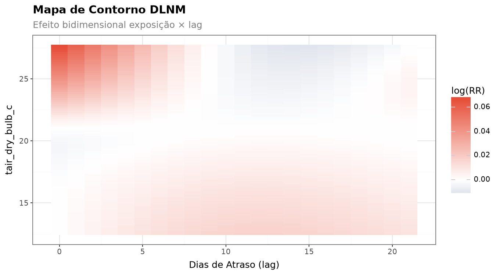
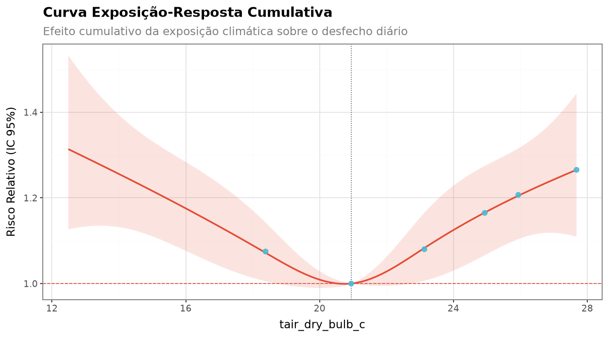
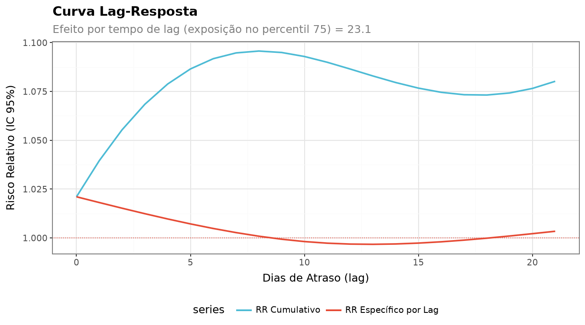
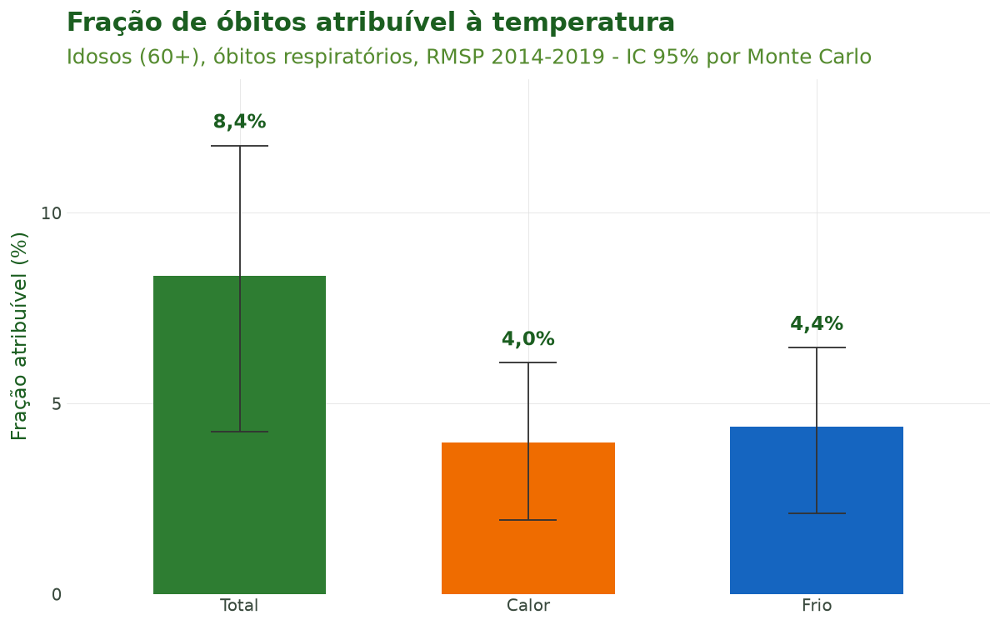

# Tutorial 9: Modelagem Epidemiológica (DLNM)

[← Voltar para a Trilha do Pipeline](pipeline.md)

## Objetivo

Ao final deste tutorial você será capaz de **transformar uma série diária de saúde alinhada ao
clima em inferência epidemiológica**: estimar a relação **não linear e defasada** entre temperatura
e mortalidade com um **DLNM** (`sus_mod_dlnm()`), quantificar a **carga atribuível** ao calor e ao
frio (`sus_mod_af()`), e conhecer as demais ferramentas de modelagem do `climasus4py` — séries
temporais interrompidas (`sus_mod_its()`), case-crossover (`sus_mod_casecrossover()`) e
meta-análise multicidade (`sus_mod_pool()`).

A modelagem é a **última etapa** do pipeline. Ela consome a saída das etapas anteriores (a série de
saúde dos Tutoriais 1 a 5 e a exposição climática do Tutorial 7) e produz **estimativas de risco
relativo**, **frações atribuíveis** e visualizações prontas para publicação.

## Contexto científico

A epidemiologia ambiental moderna trata a associação entre uma exposição ambiental (temperatura,
poluentes) e um desfecho diário de contagem (óbitos, internações) como um problema **não linear** e
**defasado no tempo**. O calor extremo mata no mesmo dia ou em 1–2 dias (efeito agudo); o frio mata
ao longo de uma a duas semanas (efeito tardio e prolongado). Modelar apenas a temperatura do dia
subestima o efeito do frio.

O **Distributed Lag Non-linear Model (DLNM)** de **Gasparrini, Armstrong & Kenward (2010)** resolve
isso com uma **cross-basis**: a combinação de duas bases de splines — uma na dimensão da
**exposição** (captura a curva em U/J: o risco sobe no frio e no calor) e outra na dimensão do
**lag** (captura como o efeito se distribui ao longo dos dias). O método foi implementado no pacote
`dlnm` do R (**Gasparrini, 2011**); `sus_mod_dlnm()` constrói a mesma cross-basis em Python.

O ajuste segue as boas práticas de **regressão de séries temporais em epidemiologia ambiental**
sistematizadas por **Bhaskaran et al. (2013)**: modelo log-linear quasi-Poisson (robusto à
superdispersão) e controle de tendência de longo prazo e sazonalidade por spline natural do tempo.
O ajuste para dia da semana, também recomendado, não é incluído automaticamente por
`sus_mod_dlnm()`: entra como covariável, com colunas indicadoras do dia passadas em `covariates`. A
**fração atribuível** decompõe a carga total de eventos em componentes de calor e frio
(**Gasparrini & Armstrong, 2013**).

**Caso condutor.** Investigamos a **temperatura e os desfechos de saúde em idosos (60+) na Região
Metropolitana de São Paulo, 2014–2019**. Aqui juntamos a **série diária de óbitos respiratórios**
dos oito municípios com a **temperatura média diária da estação A701** (São Paulo – Mirante de
Santana, Tutorial 7), montamos a estrutura de lags distribuídos e ajustamos o DLNM para estimar a
curva exposição-resposta e a carga atribuível ao calor e ao frio.

## Dados utilizados

| Entrada | Origem | Conteúdo | Papel |
|---|---|---|---|
| Série diária de óbitos respiratórios de idosos (60+), por município de residência | Tutoriais 1 a 5 | 70.742 óbitos, 2014–2019 | Desfecho `n_obitos` |
| Temperatura média diária da estação A701 | Tutorial 7 | Série horária com lacunas preenchidas | Exposição `tair_dry_bulb_c` |

`sus_climate_aggregate(temporal_strategy="distributed_lag")` liga as duas séries e expande a
exposição em colunas de **lag distribuído** (`tair_dry_bulb_c_lag0`, …, `tair_dry_bulb_c_lag21`):
a temperatura do próprio dia e de cada um dos 21 dias anteriores.

## Pipeline completo

Os blocos abaixo reproduzem o que o script
[`tools/tutoriais/tutorial_09_modelagem.py`](https://github.com/climasus/climasus4py/blob/main/tools/tutoriais/tutorial_09_modelagem.py)
executa. Comece refazendo, a partir do cache, a série diária de saúde (Tutoriais 1 a 5) e a série
climática da A701 (Tutorial 7):

```python
import climasus4py as cs

obitos = cs.sus_data_import(system="SIM-DO", uf="SP", year=[2014, 2015, 2016, 2017, 2018, 2019])
obitos_limpo = cs.sus_data_clean_encoding(obitos)
obitos_padr = cs.sus_data_standardize(obitos_limpo, lang="pt")

RMSP = ["São Paulo", "Guarulhos", "São Bernardo do Campo", "Santo André",
        "Osasco", "Mauá", "Carapicuíba", "Diadema"]
resp_idosos = cs.sus_filter(obitos_padr, groups="respiratory", age_min=60, city=RMSP)
obitos_vars = cs.sus_data_create_variables(
    resp_idosos,
    age_breaks=[60, 70, 80, 999],
    age_labels=["60-69", "70-79", "80+"],
    climate_region="sudeste",
    lang="pt",
)
serie_diaria = cs.sus_data_aggregate(obitos_vars, time_unit="day", join_col="residencia", lang="pt")
saude_espacial = cs.sus_spatial_join(serie_diaria, geo_level="municipality", join_col="residencia", lang="pt")

clima_horario = cs.sus_climate_inmet(years=[2014, 2015, 2016, 2017, 2018, 2019], uf="SP", station_code="A701", lang="pt")
clima_preenchido = cs.sus_climate_fill_inmet(clima_horario.df(), target_var="tair_dry_bulb_c", lang="pt")
```

### Montar a entrada do DLNM (lags distribuídos)

`sus_mod_dlnm()` espera uma tabela com a coluna `date`, o desfecho e as colunas
`{variável}_lag0 … _lagL`. É o que `sus_climate_aggregate()` produz com a estratégia
`distributed_lag`:

```python
df_dl = cs.sus_climate_aggregate(
    saude_espacial,                       # série de saúde (Tutoriais 1 a 5)
    clima_preenchido,                     # temperatura da A701 (Tutorial 7)
    temporal_strategy="distributed_lag",
    lag_days=list(range(22)),             # lags 0 a 21
    climate_vars=["tair_dry_bulb_c"],
)
```

Os primeiros 21 dias de 2014 ficam sem a história completa de exposição (pediriam temperaturas de
2013) e não entram no modelo: são analisados 2.170 dias e 70.170 óbitos.

### Ajustar o DLNM (`sus_mod_dlnm`)

Cross-basis com **exposição** em spline natural de 4 graus de liberdade (captura o U/J calor + frio)
e **lag** em spline natural de 3 graus (decaimento suave), família **quasi-Poisson** e controle
sazonal com `dof_per_year=6`, recomendado para o Brasil subtropical. Os óbitos dos oito municípios
são somados por dia, formando uma única série:

```python
fit = cs.sus_mod_dlnm(
    df_dl.df(),
    outcome_col="n_obitos",
    climate_col="tair_dry_bulb_c",
    lag_max=21,
    argvar={"fun": "ns", "df": 4},   # dimensão exposição
    arglag={"fun": "ns", "df": 3},   # dimensão lag
    family="quasipoisson",
    dof_per_year=6,                  # graus de liberdade por ano para a sazonalidade
    lang="pt",
)

fit["exposure_response"]         # RR cumulativo nos percentis da temperatura
fit["lag_response"]              # RR por lag no percentil 75
fit["diagnostics"]["disp_ratio"]
```

### Fração atribuível ao calor e ao frio (`sus_mod_af`)

A partir do DLNM ajustado, decompomos a carga total de óbitos em componentes de **calor** (acima da
temperatura de referência) e **frio** (abaixo), com IC por simulação de **Monte Carlo**:

```python
af = cs.sus_mod_af(
    fit,
    by="month",    # quebra mensal opcional
    nsim=200,      # use 5000 para qualidade de publicação
    seed=2026,     # fixa o sorteio do Monte Carlo
    lang="pt",
)

af["total"]       # FA e número atribuível: total, calor e frio
af["by_period"]   # quebra mensal
```

O valor central da fração atribuível não depende do sorteio; só o intervalo de confiança muda com
`nsim` e `seed`.

### Visualizar (`sus_mod_plot_dlnm`)

O pacote oferece visualizações prontas — curva exposição-resposta, lag-resposta, superfície,
contorno, fatias por lag, distribuição e série temporal:

```python
cs.sus_mod_plot_dlnm(fit, type="overall", lang="pt")   # exposição-resposta
cs.sus_mod_plot_dlnm(fit, type="contour", lang="pt")   # superfície log(RR)
cs.sus_mod_plot_dlnm(fit, type="lag", lang="pt")       # lag-resposta
```

## Características das funções

### `sus_mod_dlnm()` — Distributed Lag Non-linear Model

| Argumento | Essencial? | Descrição |
|---|---|---|
| `df` | sim | Tabela com `date`, o desfecho e as colunas `{variável}_lag0 … _lagL` (saída de `sus_climate_aggregate(temporal_strategy="distributed_lag")`) |
| `outcome_col` | sim | Coluna de contagem diária (ex.: `"n_obitos"`) |
| `climate_col` | opcional | Nome da exposição sem o sufixo `_lagN`; sem ele, é detectado |
| `lag_max` | opcional | Lag máximo; sem ele, usa o maior `_lagN` presente |
| `argvar` | opcional | Base da **exposição** (ex.: `{"fun": "ns", "df": 4}`) |
| `arglag` | opcional | Base do **lag** (ex.: `{"fun": "ns", "df": 3}`) |
| `family` | opcional | `"quasipoisson"` (padrão), `"poisson"` ou `"negbin"` (vira quasi-Poisson) |
| `ns_df` / `dof_per_year` | opcional | Graus de liberdade do spline do tempo (sazonalidade); padrão 4 por ano |
| `ref_value` | opcional | Valor de referência (RR = 1); sem ele, a mediana |
| `covariates` | opcional | Confundidores lineares adicionais (umidade etc.) |

**Retorno:** um dicionário com `"model"` (o GLM), `"crossbasis"`, `"pred"` (predições numa grade de
100 pontos), `"exposure_response"`, `"lag_response"`, `"models"` (resumo de uma linha),
`"data_daily"` e `"diagnostics"` (dispersão, autocorrelação de Ljung-Box, AIC).

### `sus_mod_af()` — Fração e Número Atribuível

| Argumento | Descrição |
|---|---|
| `fit` | Saída de `sus_mod_dlnm()` |
| `threshold` | Limiar que separa calor (acima) e frio (abaixo); sem ele, a referência do DLNM |
| `pred_at` | Percentis das faixas (padrão `(0.75, 0.90, 0.95, 0.99)`) |
| `by` | Quebra temporal: `"month"`, `"year"`, `"season"` ou nenhuma |
| `nsim` | Simulações de Monte Carlo para o IC (padrão 1000) |
| `seed` | Semente do sorteio, para resultados reprodutíveis |
| `alpha` | Nível de significância (padrão 0,05 → IC 95%) |

**Retorno:** um dicionário com `"total"` (total, calor e frio), `"by_quantile"`, `"by_period"`,
`"daily"` e `"custom"`. O número atribuível de cada dia é `óbitos × (1 − 1/RR)`, com o RR
cumulativo da temperatura daquele dia.

### `sus_mod_its()` — Séries Temporais Interrompidas

Regressão Poisson **segmentada** para o efeito de intervenções (políticas, eventos extremos,
pandemia) sobre uma série de contagem (Bernal et al., 2017).

| Argumento | Descrição |
|---|---|
| `data` | Série com data e contagem |
| `outcome_col` / `date_col` | Colunas de desfecho e data |
| `interruption_dates` | Uma ou mais datas de intervenção (dentro do período) |
| `harmonics` | Pares de senos e cossenos para a sazonalidade (padrão 2) |
| `family` | `"quasipoisson"` (padrão) ou `"poisson"` |
| `counterfactual` | Projeta a tendência anterior à intervenção (padrão `True`) |

**Retorno:** um objeto com `.effects` (mudança de nível e de tendência), `.counterfactual` e
`.segments`.

### `sus_mod_casecrossover()` — Case-Crossover Estratificado no Tempo

Cada estrato temporal (mês ou semana) é seu próprio controle, removendo tendência e sazonalidade
**por desenho** (Maclure, 1991).

| Argumento | Descrição |
|---|---|
| `data` | Série com `date`, desfecho e exposição |
| `outcome_col` / `exposure_col` | Desfecho e exposição |
| `stratum` | `"month"` (padrão), `"week"` ou uma coluna existente |
| `lag` | Lag único ou lista (média móvel, ex.: `[0, 1, 2, 3, 4, 5, 6]`) |
| `method` | `"conditional_poisson"` (padrão) ou `"clogit"` |
| `family` | `"quasipoisson"` (padrão) ou `"poisson"` |

**Retorno:** um objeto com `.or_table` (OR, IC, p) e `.diagnostics`.

### `sus_mod_pool()` — Meta-análise Multicidade

Combina estimativas DLNM de várias cidades por **meta-análise multivariada** (REML), produzindo curva
combinada, heterogeneidade (Q, I²) e BLUPs por cidade.

| Argumento | Descrição |
|---|---|
| `fits` | Dicionário `{cidade: saída de sus_mod_dlnm()}`, todas com a mesma cross-basis |
| `method` | `"reml"` (padrão), `"ml"` ou `"fixed"` |
| `blup` | Calcula predições BLUP por cidade (padrão `True`) |
| `pred_at` | Percentis da tabela combinada |

**Retorno:** um dicionário com `"exposure_response"`, `"lag_response"`, `"heterogeneity"`,
`"city_table"` e `"blup_preds"`.

### Decisões de modelagem

- **Superdispersão.** Contagens de óbitos costumam ter variância maior que a média (razão de
  dispersão acima de 1). A família **quasi-Poisson** infla o erro-padrão por essa razão e é
  recomendada quando ela passa de ~1,5 (Armstrong, 2006). A alternativa binomial negativa é
  redirecionada para quasi-Poisson.
- **Escolha de nós e lags.** Para a **exposição**, `ns` com 4 gl captura bem a forma em U/J (frio +
  calor); 3 gl é mais conservador, 5 gl exige muitos dados. Para o **lag**, `ns` com 3 gl modela o
  decaimento suave típico de temperatura-mortalidade; o lag máximo de **21 dias** cobre o efeito
  tardio e prolongado do frio (Gasparrini, 2011).
- **Sazonalidade.** O spline natural do tempo absorve a tendência de longo prazo e o ciclo anual
  que confundem a associação. Recomendam-se ~4 gl por ano para 1–2 anos e **6–8** para o Brasil
  subtropical e doenças com forte sazonalidade (Bhaskaran et al., 2013). Subajustar deixa
  autocorrelação nos resíduos (teste de Ljung-Box em `fit["diagnostics"]`); superajustar consome o
  sinal.

## Resultados ilustrados



**Figura 1.** Superfície de resposta do DLNM (`sus_mod_plot_dlnm(type="contour")`): `log(RR)` de
óbitos respiratórios de idosos em função da temperatura (eixo vertical) e do dia de atraso (eixo
horizontal). O calor (acima de ~23 °C) eleva o risco nos primeiros dias; o frio (abaixo de ~18 °C)
eleva o risco de forma mais fraca e espalhada por vários dias. A estrutura bidimensional revela
quando, após cada nível de exposição, o efeito se manifesta.



**Figura 2.** Curva exposição-resposta **cumulativa** (RR e IC 95%) somada sobre os 22 dias de lag,
centrada na mediana da temperatura (20,9 °C, RR = 1). A forma em U — risco crescente no frio e no
calor — é a assinatura clássica da relação temperatura-mortalidade: o RR chega a 1,31 no dia mais
frio da série (12,5 °C) e a 1,27 no percentil 99 (27,7 °C).



**Figura 3.** Curva **lag-resposta** no percentil 75 da temperatura (23,1 °C). O RR específico de
cada dia é maior no próprio dia (1,02) e cai até perto de 1 em uma semana; o RR cumulativo chega a
~1,09 no lag 7 e se estabiliza perto de 1,08. É o perfil de um efeito agudo do calor, concentrado
nos primeiros dias.



**Figura 4.** Fração de óbitos atribuível à temperatura (%), decomposta em **total**, **calor** e
**frio**, com IC 95% por Monte Carlo. Cerca de 8,4% dos óbitos respiratórios de idosos na RMSP em
2014–2019 são atribuíveis à temperatura fora da referência, divididos de forma parecida entre frio
(4,4%) e calor (4,0%).

**Tabela 1.** Resumo do ajuste do DLNM (especificação, RR e diagnósticos).

| Item | Valor |
|---|---|
| Período / dias analisados | 2014–2019 / 2.170 |
| Óbitos analisados | 70.170 |
| Exposição | Temperatura média diária, estação A701 |
| Base da exposição × lag | ns (4 gl) × ns (3 gl) |
| Lag máximo | 21 dias |
| Família / sazonalidade | quasi-Poisson / 6 gl por ano |
| Referência (RR = 1) | 20,9 °C (mediana) |
| RR no P25 (frio) | 1,07 [1,01–1,15] a 18,4 °C |
| RR no P75 | 1,08 [1,01–1,16] a 23,1 °C |
| RR no P99 (calor) | 1,27 [1,11–1,44] a 27,7 °C |
| Razão de dispersão | 1,20 |
| Autocorrelação residual (Ljung-Box) | p = 0,005 |

A razão de dispersão de 1,20 indica superdispersão leve, que a quasi-Poisson absorve. O teste de
Ljung-Box (p = 0,005) aponta autocorrelação residual: a função sugere aumentar `dof_per_year`, e
vale testar a sensibilidade dos resultados a esse ajuste antes de publicar.

**Tabela 2.** Fração atribuível (FA) e número de óbitos atribuíveis por componente térmico (IC 95%,
200 simulações de Monte Carlo).

| Componente | FA (%) | Óbitos atribuíveis |
|---|---|---|
| Total | 8,36 [4,27–11,77] | 5.867 [2.995–8.256] |
| Calor | 3,97 [1,95–6,07] | 2.784 [1.365–4.259] |
| Frio | 4,39 [2,13–6,47] | 3.083 [1.494–4.540] |

## Referências

- Armstrong, B. (2006). Models for the relationship between ambient temperature and daily
  mortality. *Epidemiology*, 17(6), 624–631.
- Bernal, J. L., Cummins, S., & Gasparrini, A. (2017). Interrupted time series regression for the
  evaluation of public health interventions: a tutorial. *International Journal of Epidemiology*,
  46(1), 348–355. <https://doi.org/10.1093/ije/dyw098>
- Bhaskaran, K., Gasparrini, A., Hajat, S., Smeeth, L., & Armstrong, B. (2013). Time series
  regression studies in environmental epidemiology. *International Journal of Epidemiology*,
  42(4), 1187–1195. <https://doi.org/10.1093/ije/dyt092>
- Gasparrini, A. (2011). Distributed lag linear and non-linear models in R: the package dlnm.
  *Journal of Statistical Software*, 43(8), 1–20. <https://doi.org/10.18637/jss.v043.i08>
- Gasparrini, A., Armstrong, B., & Kenward, M. G. (2010). Distributed lag non-linear models.
  *Statistics in Medicine*, 29(21), 2224–2234. <https://doi.org/10.1002/sim.3940>
- Gasparrini, A., & Armstrong, B. (2013). Reducing and meta-analysing estimates from distributed
  lag non-linear models. *BMC Medical Research Methodology*, 14, 70.
  <https://doi.org/10.1186/1471-2288-14-70>
- Maclure, M. (1991). The case-crossover design: a method for studying transient effects on the
  risk of acute events. *American Journal of Epidemiology*, 133(2), 144–153.

## Navegação

- [Voltar para a Trilha do Pipeline](pipeline.md)
- **Anterior:** [Tutorial 8 — Clima em Grade e Dados Ambientais](08-clima-grade.md)
- Este é o **último tutorial** da trilha do pipeline do `climasus4py`.
